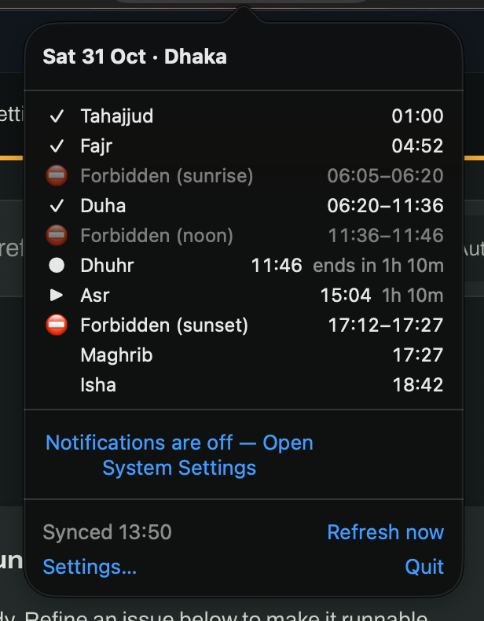
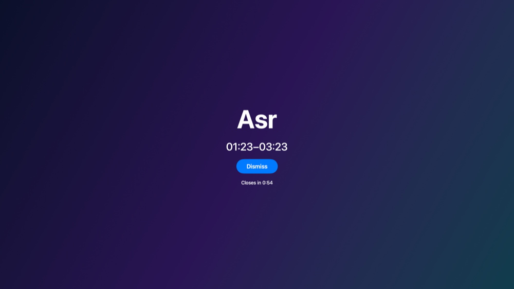
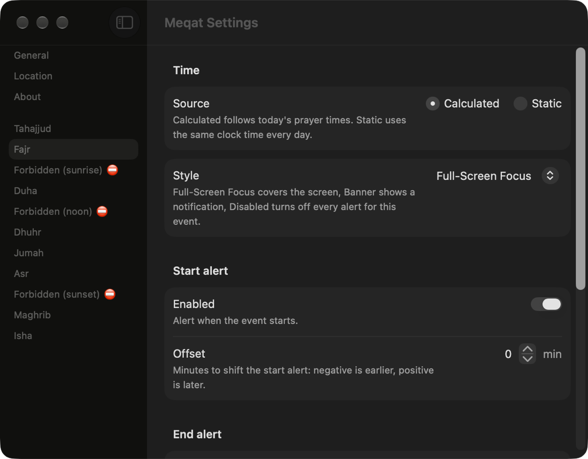

<p align="center">
  
</p>

<h1 align="center">Meqat</h1>

<p align="center">Menu bar prayer times, prohibited windows and per-event alerts</p>

<p align="center">
  <a href="https://github.com/masnun-siam/meqat/releases/latest"></a>
  
  <a href="https://github.com/masnun-siam/meqat/actions/workflows/ci.yml"></a>
</p>

<p align="center">
  <a href="https://github.com/masnun-siam/meqat/releases/latest">Download</a> ·
  <a href="#install">Install</a> ·
  <a href="#features">Features</a>
</p>

## Demo







## Why

Prayer times are easy to find, but a desktop tool that fits how a person actually prays is harder. One alert style for every prayer is easy to miss or too intrusive, and the prohibited windows, Duha, Jumah and Tahajjud get little attention. Meqat lets you choose how hard each event interrupts you, shows the prohibited windows, and keeps working offline or while travelling.

## Features

| Area | What you get |
|---|---|
| Events | 11 events: the 5 prayers, Jumah (Fridays), Duha, Tahajjud and the 3 prohibited windows (Shuruq, Istiwa, Ghurub) |
| Alerts | Per-event style (full-screen overlay, banner or silent), start offset, end alert and pre-warning |
| Mosque times | Static times to match your mosque instead of the calculated ones |
| Menu bar | Countdown to the next event; shows ⛔ and the time left inside a prohibited window |
| Offline | 30+ days of cached times |
| Location | Automatic, or a manually entered city |
| Calculation | Choose the calculation method and Asr school |
| System | Launch at login; About pane and an update notice when a newer release exists |

## Install

Requires macOS 14 (Sonoma) or later.

```sh
brew install masnun-siam/tap/meqat
```

Or download the DMG from the [releases page](https://github.com/masnun-siam/meqat/releases) and drag Meqat to Applications.

The build is not notarized, so macOS blocks the first launch. Run once:

```sh
xattr -dr com.apple.quarantine /Applications/Meqat.app
```

or open the app, then choose Open Anyway in System Settings › Privacy & Security.

## Usage / first launch

Meqat lives in the menu bar and has no Dock icon. On first launch it asks for your location, or you can enter a city instead. Open Settings from the dropdown to set the calculation method, the alert style of each event and more.

## Privacy

- Coordinates are rounded to about 1 km before use.
- Only the rounded coordinates, or the city you typed, go to `api.aladhan.com`.
- The only other request is the update check to GitHub.
- No telemetry and no accounts.

## Development

| Part | Path | What |
|---|---|---|
| MeqatCore | `MeqatCore/` | Swift package with all logic and its XCTest suite |
| Meqat app | `Meqat/`, `Meqat.xcodeproj` | AppKit + SwiftUI menu bar app (scheme `Meqat`) |
| Release | `scripts/release.sh`, `Config/` | Ad-hoc signed, un-notarized DMG, built on the owner's Mac |

No services, ports or third-party packages.

### Prerequisites

- macOS 14 or later, Xcode 26 or later (CI uses the `macos-26` runner; older SDKs report Sendable warnings, which fail the build).
- For commits: `brew install pre-commit && pre-commit install` (installs the pre-commit and pre-push hooks).

### Quickstart

```sh
make help     # list targets
make test     # MeqatCore tests (the live Aladhan test is skipped)
make build    # ad-hoc signed Debug app
make run      # build and launch: a text item (next event) appears in the menu bar, no Dock icon
make check    # lint + test + build, what CI runs
```

Quit from the menu bar dropdown. Build output goes to `$TMPDIR/meqat/<worktree folder>/`, one folder per worktree, so parallel worktrees never share products and a repo on an ExFAT drive still signs. `make clean` removes it. `make format` fixes lint findings.

### Debug harnesses

Debug builds can open one surface with mock data, without location or network:

```sh
make run HARNESS=Overlay   # or Menu, Settings, LoginItem
```

See `Meqat/Debug/`.

### Live API tests

```sh
make test-live
```

### Checks

| Where | What |
|---|---|
| pre-commit | no commits to `main`, gitleaks secret scan, no lint/warning suppressions, `swift format lint --strict`, `CLAUDE.md` guards, YAML/JSON |
| pre-push | `make test` and `make build` when Swift or project files changed |
| CI (`.github/workflows/ci.yml`) | the hooks above on Ubuntu; `make lint test build` on macOS, skipped when only `*.md` or `docs/` changed; `summary` is the required check |
| PR meta (`.github/workflows/pr-meta.yml`) | the PR body references an issue; re-runs on title/body edits |

Warnings are errors in `make test` and `make build`. Formatting rules: `.swift-format`.

## Docs

Docs index: [`docs/README.md`](docs/README.md). Conventions, workflow, PRD and release steps are linked from there and from `CLAUDE.md` (rules for AI agents; `AGENTS.md` links to it).

## Credits

Prayer times come from the [Aladhan API](https://aladhan.com/prayer-times-api).
