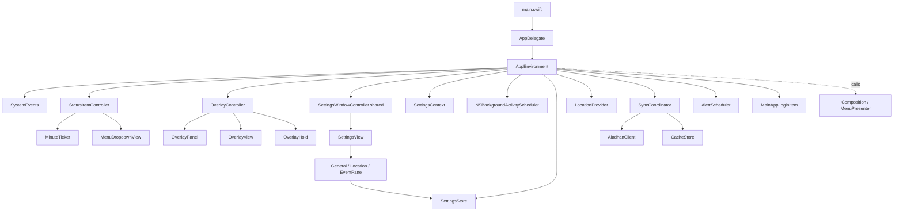
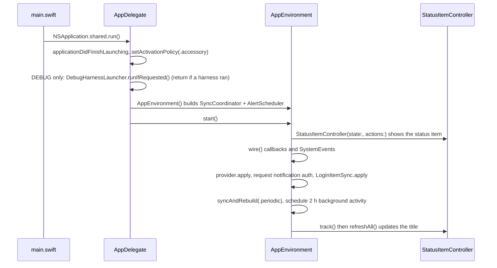

# App target

Covers: Meqat/, Config/, Meqat.xcodeproj/

AppKit + SwiftUI menu bar app (target `Meqat`) that wires `MeqatCore` ([meqatcore.md](meqatcore.md)). It has no business logic of its own. Rules: [guides/app-conventions.md](guides/app-conventions.md).

## Files

All under `Meqat/`. Everything is `@MainActor` unless noted.

| File | Types | Role |
|---|---|---|
| `main.swift` | n/a | Creates `AppDelegate`, sets it on `NSApplication.shared`, runs. |
| `App/AppDelegate.swift` | `AppDelegate` | Sets accessory policy, optionally runs a debug harness, starts `AppEnvironment`. |
| `App/AppEnvironment.swift` | `AppEnvironment` | Composition root: owns every component, wiring, transient menu state, observation of sync/location. |
| `App/SystemEvents.swift` | `SystemEvents` | Sleep, wake, clock, time zone and terminate notifications as closures. |
| `MenuBar/StatusItemController.swift` | `StatusItemController` | `NSStatusItem` title plus an `NSPopover` hosting the dropdown. |
| `MenuBar/MenuDropdownView.swift` | `MenuDropdownView`, `MenuRowView` (private) | SwiftUI dropdown rendering a `MenuState`. |
| `MenuBar/MenuActions.swift` | `MenuActions` | Closures the dropdown calls (refresh, settings, quit...). |
| `MenuBar/MinuteTicker.swift` | `MinuteTicker` | Fires just after each wall-clock minute; `rearm()` after clock changes. |
| `Overlay/OverlayController.swift` | `OverlayController` | Shows the full-screen overlay per screen; hides on lock/screensaver; uses `OverlayHold`. |
| `Overlay/OverlayPanel.swift` | `OverlayPanel` | `NSPanel` subclass for the overlay window. |
| `Overlay/OverlayView.swift` | `OverlayView`, `OverlayModel` | SwiftUI overlay content and its observable model. |
| `Overlay/OverlayContent.swift` | `OverlayContent` | Event name, start, end and hold seconds. |
| `Settings/SettingsWindowController.swift` | `SettingsWindowController` (`.shared`) | Lazily creates the Settings window; needs `store` and `context` set first. |
| `Settings/SettingsView.swift` | `SettingsView`, `SettingsNavigation` | Sidebar `NavigationSplitView` switching panes. |
| `Settings/SettingsPane.swift` | `SettingsPane` | `general`, `location`, `event(EventID)`. |
| `Settings/SettingsContext.swift` | `SettingsContext`, `LookupStatus` | Runtime, non-setting data panes show (windows, place, last sync, lookup status). |
| `Settings/GeneralPane.swift` | `GeneralPane` | Launch at login, method, school, durations, reset all. |
| `Settings/LocationPane.swift` | `LocationPane` | Automatic/manual location, uses `ManualCityInput`. |
| `Settings/EventPane.swift` | `EventPane` | Per-event settings, uses `StaticTimeHint`. |
| `Debug/DebugHarness.swift` | `DebugHarness`, `DebugHarnessLauncher` | `#if DEBUG` only: launch with `-MeqatDebugHarness <Name>` to run `MeqatDebug<Name>Harness`. |
| `Debug/{LoginItem,Menu,Overlay,Settings}DebugHarness.swift` | `LoginItemDebugHarness`, `MenuDebugHarness`, `OverlayDebugHarness`, `SettingsDebugHarness` | One harness per UI area (names `LoginItem`, `Menu`, `Overlay`, `Settings`). |

## Object graph

Flow back into the app: `store.onChange`, `provider.onChange`, `coordinator.onCacheReplaced`, `scheduler.onFullScreen` / `onBannerFired` all land in `AppEnvironment.wire()`. `track()` re-registers `withObservationTracking` on `coordinator.status`, `provider.state` and `scheduler.notificationsAuthorized`.

## Startup

## Build settings

From `Meqat.xcodeproj/project.pbxproj` (Debug and Release agree on these):

| Setting | Value |
|---|---|
| `MACOSX_DEPLOYMENT_TARGET` | 14.0 |
| `PRODUCT_BUNDLE_IDENTIFIER` | `com.masnunsiam.Meqat` |
| `MARKETING_VERSION` / `CURRENT_PROJECT_VERSION` | 1.0.0 / 1 |
| `SWIFT_VERSION` | 5.0 |
| `GENERATE_INFOPLIST_FILE` | YES (no checked-in Info.plist) |
| `INFOPLIST_KEY_LSUIElement` | YES (no Dock icon, menu bar only) |
| `INFOPLIST_KEY_NSLocationUsageDescription`, `INFOPLIST_KEY_NSLocationWhenInUseUsageDescription` | Same text: location is rounded to about 1 km and sent only to Aladhan |
| `ENABLE_HARDENED_RUNTIME` | YES |
| `CODE_SIGN_STYLE` | Automatic |
| `CODE_SIGN_ENTITLEMENTS` | `Config/Meqat.entitlements` |
| Debug only | `SWIFT_ACTIVE_COMPILATION_CONDITIONS = DEBUG` (enables `Debug/`) |
| Dependency | Local Swift package `MeqatCore` (`relativePath = MeqatCore`) |

`Config/Meqat.entitlements`: `com.apple.security.app-sandbox`, `com.apple.security.network.client`, `com.apple.security.personal-information.location` (all true). `make build` and `scripts/release.sh` override `CODE_SIGN_ENTITLEMENTS` to empty and sign ad hoc, so shipped builds carry none and the sandbox stays off.
