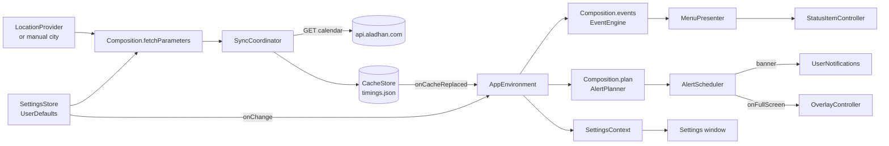

# Architecture

Covers: `MeqatCore/Sources/MeqatCore/App/Composition.swift`, `Meqat/App/`

Two parts: `MeqatCore` (Swift package, all logic, tested) and the `Meqat` app target (AppKit + SwiftUI, wires and renders). Structure of each: [meqatcore.md](meqatcore.md), [app.md](app.md).

## Data flow

- `AppEnvironment` (`Meqat/App/AppEnvironment.swift`) is the only composition root: it builds the core objects, assigns their callbacks in `wire()`, and recomputes the menu and settings context in `refreshAll()`.
- `Composition` (`MeqatCore/Sources/MeqatCore/App/Composition.swift`) holds the pure glue: `events(cache:settings:now:timeZone:)`, `plan(...)`, `fetchParameters(location:settings:timeZone:)`.
- Everything below `AppEnvironment` is either a pure `enum` (engine, planner, presenter, policy) or a `@MainActor @Observable` class with injected clocks and protocols; see `docs/guides/meqatcore-conventions.md`.

## State and stores

| State | Where | Lifetime |
|---|---|---|
| Settings (general, location, per-event) | `SettingsStore`, `UserDefaults` | persistent |
| Prayer timings, yesterday to today + 30 days | `CacheStore`, `timings.json` in Application Support | persistent, replaced on sync |
| Sync status, last success, failure | `SyncCoordinator` | in memory |
| Location fix and authorization | `LocationProvider` | in memory (rounded fix); the location used for a fetch is stored in the cache |
| Pending alerts | `AlertScheduler`, `UNUserNotificationCenter`, one `DispatchAlertTimer` | rebuilt on every change |
| Overlay hold and countdown | `OverlayController`, `OverlayHold` | while shown |

## Triggers

| Event | Effect | Detail |
|---|---|---|
| Launch (`start()`) | apply location, request notification permission, sync login item, sync + rebuild, show status item | [app.md](app.md) |
| Wake / time-zone change (`SystemEvents`) | sync check + alert rebuild, refresh UI, re-arm minute ticker | [prayer-times-sync.md](features/prayer-times-sync.md) |
| Clock change | alert rebuild, refresh UI (no sync) | [alerts.md](features/alerts.md) |
| Sleep / quit | `AlertScheduler.suspend()` | [alerts.md](features/alerts.md) |
| Every 2 hours (`NSBackgroundActivityScheduler`) | sync check + alert rebuild | [prayer-times-sync.md](features/prayer-times-sync.md) |
| Location change (`LocationProvider.onChange`) | sync, refresh UI | [location.md](features/location.md) |
| Settings change (`settingsChanged(old, new)`) | resync when location, method or school changed; always rebuild alerts and refresh UI | [settings.md](features/settings.md) |
| Cache replaced (`onCacheReplaced`) | rebuild alerts, refresh UI | [alerts.md](features/alerts.md) |
| Each minute (`MinuteTicker`) | status title refresh | [menu-bar.md](features/menu-bar.md) |
| Alert time | banner or full-screen overlay | [alerts.md](features/alerts.md), [overlay.md](features/overlay.md) |

## External boundaries

| Boundary | Wrapped by | Notes |
|---|---|---|
| Aladhan HTTP API | `AladhanClient` over `HTTPTransport` | only network call; no API key |
| CoreLocation | `LocationProvider` over `LocationManaging` | coordinates rounded before use ([location.md](features/location.md)) |
| UserNotifications | `AlertScheduler` over `NotificationCentering` | banners |
| ServiceManagement | `LoginItemSync` over `LoginItemService` | [launch-at-login.md](features/launch-at-login.md) |
