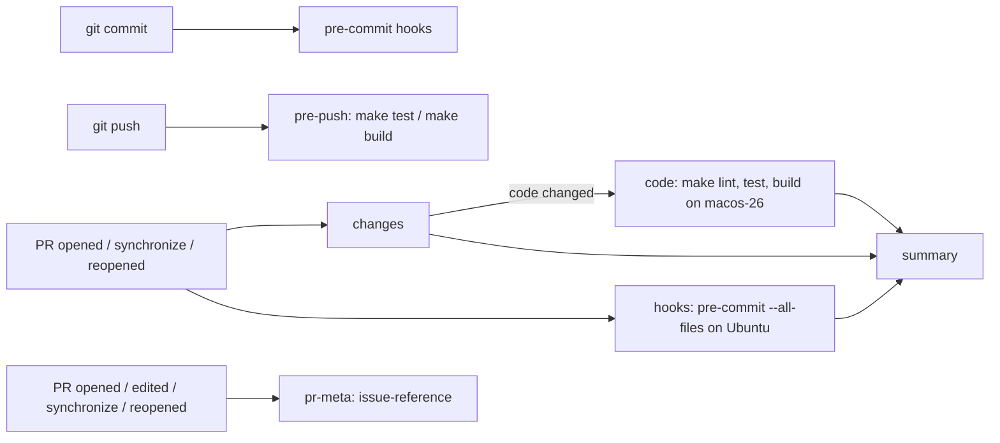

# Development

Covers: `Makefile`, `.swift-format`, `.pre-commit-config.yaml`, `.github/`, `.claude/`, `scripts/`, `Config/`, `Meqat.xcodeproj/`, `MeqatCore/Package.swift`

Quickstart commands are in the root `README.md`; this doc is the detail behind them.

## Toolchain

| Need | Version / source |
|---|---|
| Xcode | 26+ (CI: `macos-26` runner). Older SDKs (Xcode 16 / Swift 6.1) warn that `UNUserNotificationCenter` is not `Sendable` (`MeqatCore/Sources/MeqatCore/Alerts/NotificationCentering.swift`), which fails `make test` |
| Swift package | `swift-tools-version:5.9`, `.macOS(.v14)` (`MeqatCore/Package.swift`) |
| App | `MACOSX_DEPLOYMENT_TARGET = 14.0`, `SWIFT_VERSION = 5.0` (`Meqat.xcodeproj/project.pbxproj`) |
| Formatter | `swift format` from the Xcode toolchain; config `.swift-format` |
| Hooks | `pre-commit` (Homebrew); gitleaks is fetched by pre-commit |

## Make targets

| Target | Runs |
|---|---|
| `check` | `lint`, `test`, `build` (what CI runs) |
| `lint` / `format` | `swift format lint --strict` / `format --in-place` over `MeqatCore` and `Meqat` |
| `test` | `swift test --package-path MeqatCore` with `-warnings-as-errors` |
| `test-live` | same with `MEQAT_LIVE_TESTS=1` (hits `api.aladhan.com`, see `AladhanLiveTests.swift`) |
| `build` | ad-hoc signed Debug `xcodebuild` with `SWIFT_TREAT_WARNINGS_AS_ERRORS=YES` |
| `run` | `build`, then `open -n` the app; `HARNESS=<Name>` adds `--args -MeqatDebugHarness <Name>` |
| `clean` | removes this worktree's `BUILD_DIR` |

- `BUILD_DIR` defaults to `$TMPDIR/meqat/<worktree folder name>`: SwiftPM scratch in `core/`, DerivedData in `dd/`. Per worktree, so parallel issues never share build products.
- Build output lives off the repo because the repo drive may be ExFAT: it adds `._*` files to bundles and `codesign` fails (`CodeSign … ._Resources`). Running `swift test` without `--scratch-path` there fails the same way.
- Tests: XCTest everywhere except `StaticTimeHintTests.swift` (Swift Testing); the live test is skipped unless `MEQAT_LIVE_TESTS=1`.

## Debug harnesses

`Meqat/Debug/*`, compiled only in Debug. Each opens one surface with mock data and skips `AppEnvironment` (no location, network or status item).

| Harness | Extra launch args (from `UserDefaults`) |
|---|---|
| `Overlay` | `-MeqatDebugHold` |
| `Menu` | `-MeqatDebugEmpty` |
| `Settings` | `-MeqatDebugPane`, `-MeqatDebugWindows`, `-MeqatDebugLookup` |
| `LoginItem` | none; prints `SMAppService` status |

Adding one: `docs/guides/app-conventions.md` ("Debug harnesses").

## Gates

| Hook (`.pre-commit-config.yaml`) | Stage | Blocks |
|---|---|---|
| `no-commit-to-branch` | commit | commits on `main` |
| `check-merge-conflict`, `check-yaml`, `check-json` | commit | conflict markers, invalid YAML/JSON |
| `gitleaks` | commit | secrets |
| `claude-md-nested` / `claude-md-warn` | commit | a non-root `CLAUDE.md` / warns when the root one changes (`scripts/claude-md-guard.sh`) |
| `no-lint-suppression` | commit | `swift-format-ignore`, `swiftlint:disable`, `#warning`, `@_silgen_name`, `-suppress-warnings`, `SWIFT_SUPPRESS_WARNINGS` |
| `swift-format-lint` | commit | lint findings in staged `.swift` files |
| `make-test` | push | when `MeqatCore/`, `Makefile` or `.swift-format` changed |
| `make-build` | push | when app, core sources, project, `Config/` or `Makefile` changed |

- Install with `pre-commit install` (installs both stages via `default_install_hook_types`). Hooks only run in clones where this was done.
- CI (`.github/workflows/ci.yml`): `changes` marks a run doc-only when every changed path is `*.md` or under `docs/`; then `code` is skipped. `hooks` always runs, skipping the Swift/make hooks and the branch guard. `summary` fails if any job failed or was cancelled.
- `.github/workflows/pr-meta.yml`: fails when the PR body has no `#<number>`. Separate workflow so title/body edits re-run only it.
- `main` protection requires `summary` and `issue-reference`, a pull request, and applies to admins.
- `.claude/settings.json` runs `scripts/guard-claude-md.sh` before agent edits; it asks the human before `CLAUDE.md` or `AGENTS.md` change.
- Scripts must be committed executable (`git update-index --chmod=+x`): on ExFAT `core.fileMode` is false and git does not see mode changes.

## Release

Releases and the Homebrew cask are done by the owner on their Mac: `docs/release-checklist.md` and `scripts/release.sh`, which builds an ad-hoc signed, un-notarized DMG in `build/release/` with no credentials or network. Ad-hoc signing (`CODE_SIGN_STYLE=Manual CODE_SIGN_IDENTITY=- CODE_SIGN_ENTITLEMENTS= DEVELOPMENT_TEAM=`) binds the bundle ID and `Info.plist` to the signature, which Notification Center needs to register the app. `Config/Meqat.entitlements` holds App Sandbox, `network.client` and location, but no build embeds it.
