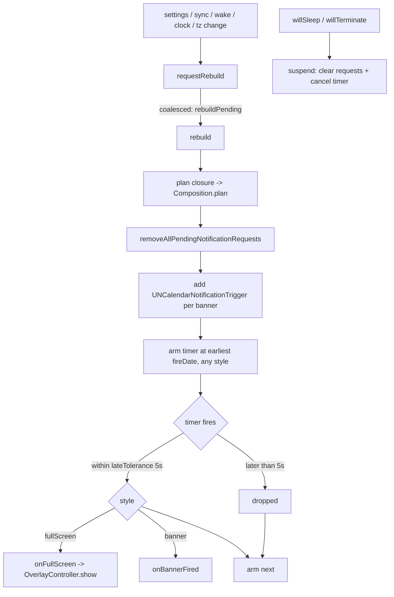

# Alerts

Covers: MeqatCore/Sources/MeqatCore/Alerts/, MeqatCore/Sources/MeqatCore/App/Composition.swift, Meqat/App/AppEnvironment.swift, MeqatCore/Tests/MeqatCoreTests/AlertPlannerTests.swift, AlertSchedulerTests.swift, CompositionTests.swift

Per-event alerts: a banner (system notification) or a full-screen overlay at a computed time. Conventions: [meqatcore-conventions](../guides/meqatcore-conventions.md), [app-conventions](../guides/app-conventions.md). Event times come from the engine ([events.md](events.md)) and the cache ([prayer-times-sync.md](prayer-times-sync.md)); the overlay itself is in [overlay.md](overlay.md).

## Settings (per event, `EventSettings` in `Settings/AppSettings.swift`)

| Field | Meaning | Default | Bound |
|---|---|---|---|
| `style` | `AlertStyle`: `.fullScreen`, `.banner`, `.disabled` | `.banner`; `.disabled` for `duha`, `tahajjud` | n/a |
| `startAlert` | `enabled`, `offsetMinutes` from event start | on, 0 | `Bounds.offsetMinutes` -60...60 |
| `endAlert` | `enabled`, `leadMinutes` before event end | off, 15 | `Bounds.leadMinutes` 1...120 |
| `preWarning` | `enabled`, `leadMinutes` before event start | off, 20 | 1...120 |
| `overlayHoldSeconds` | minimum overlay hold | 60 | `Bounds.overlayHoldSeconds` 0...300 |

Details in [settings.md](settings.md).

## AlertPlanner (pure)

`AlertPlanner.plan(events:settings:now:timeZone:)` returns `[PlannedAlert]`; `Composition.plan` feeds it `Composition.events` (yesterday through today + 2).

| Kind (`AlertKind`) | Fires at | Style | Title |
|---|---|---|---|
| `.start` | start + `offsetMinutes` | event `style` | `Asr · 15:04`; prohibited: `⛔ Ghurub · avoid praying until 17:27` |
| `.end` | end - `leadMinutes` | event `style` | `Asr ends in 15 min` |
| `.preWarning` | start - `leadMinutes` | always `.banner` | `Asr in 20 min` (`⛔ ` prefix if prohibited) |

- Id: `<yyyy-MM-dd list date>.<eventID>.<kind>`, e.g. `2026-10-28.asr.start`. It is also the notification request identifier.
- Skipped: `style == .disabled` (no alerts of any kind, including pre-warning), events with no `interval` (invalid time), fire dates not in `(now, now + AlertPlanner.horizon]` (48 h).
- Sorted by `(fireDate, id)`. Banners are capped at `AlertPlanner.maxBanners` (60, soonest kept); full-screen alerts are never capped.
- Times in titles are formatted `HH:mm` in the given time zone.

## AlertScheduler (`@MainActor @Observable`)

- Rebuild is idempotent: every rebuild wipes all pending requests and re-adds the planned banners. Concurrent `requestRebuild` calls merge into one extra pass (`rebuilding`/`rebuildPending`). `requestRebuild` also clears `suspended`.
- Banners are scheduled with the OS (`UNCalendarNotificationTrigger`, non-repeating, title only, default sound), so they fire even if the app is not running. Full-screen alerts depend on the in-process timer: one `DispatchAlertTimer` (wall-clock `DispatchSourceTimer`, `.strict`) armed at the next alert of either style.
- Late tolerance: `AlertScheduler.lateTolerance` = 5 s. A timer that wakes later than that (e.g. after sleep) drops the alert instead of showing a stale one; the timer then moves on.
- Suspension: `suspend()` runs on `willSleep` and `willTerminate`; it clears pending requests and the timer. On wake, `AppEnvironment` runs `syncAndRebuild(.wake)`. A rebuild that finds `suspended` set mid-flight removes what it added.
- `notificationsAuthorized` is refreshed after each rebuild (`isAuthorized()`: authorized or provisional). When false, a fired banner calls `onBannerFired`, which `AppEnvironment` turns into the status-item "now" state for 5 min ([menu-bar.md](menu-bar.md)); the menu also shows a "Notifications are off" row.
- A failed `center.add` is logged and the remaining banners still go in.

## Wiring (`Meqat/App/AppEnvironment.swift`)

- `scheduler.onFullScreen` builds `OverlayContent(eventName, start, end, holdSeconds)` from the alert and the event's `overlayHoldSeconds`, then `overlay.show(_:)`.
- Rebuild triggers: any settings change (`settingsChanged`), cache replaced (`onCacheReplaced`), wake, time zone change, clock change, launch (`syncAndRebuild(.periodic)`), and a 2 h `NSBackgroundActivityScheduler`.
- Notification permission is requested at launch (`.alert`, `.sound`).
- DEBUG builds log pending banner ids and fire times via `AppEnvironment.logPlan` (Logger category `app`).

## Gotchas

- A full-screen alert in the plan has no OS notification; if the app is quit or suspended it never shows.
- Pre-warnings are banners even for full-screen events.
- Changing a setting reschedules everything; there is no per-alert diffing.

## Tests

- `AlertPlannerTests`: offsets/leads, static time, disabled, titles, horizon, banner cap, bounds, same-instant ids.
- `AlertSchedulerTests` (fake center and timer): pending set equals plan banners, rebuild merging, tolerance drop, suspend, authorization, failed add.
- `CompositionTests`: default plan is banners only and bounded.

## Debug harness

No dedicated alert harness. Use the overlay harness for full-screen ([overlay.md](overlay.md)); DEBUG logs show the banner plan.
