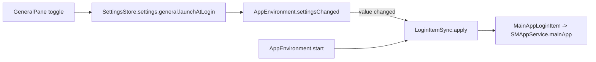

# Launch at login

Covers: MeqatCore/Sources/MeqatCore/LoginItem/LoginItemSync.swift, Meqat/App/AppEnvironment.swift, Meqat/Settings/GeneralPane.swift, Meqat/Debug/LoginItemDebugHarness.swift, MeqatCore/Tests/MeqatCoreTests/LoginItemSyncTests.swift

Keeps the macOS login item in step with `GeneralSettings.launchAtLogin` (default `true`, see [settings.md](settings.md)).

## Pieces

| Symbol | Role |
|---|---|
| `LoginItemService` | protocol: `isEnabled`, `register()`, `unregister()` |
| `MainAppLoginItem` | wraps `SMAppService.mainApp`; `isEnabled` is `status == .enabled` (`.requiresApproval` counts as not enabled) |
| `LoginItemSync.apply(_:to:)` | no-op if `isEnabled == wanted`; otherwise register/unregister. Returns the error, logs it (Logger category `login-item`), never throws |

## Flow

- Launch: `AppEnvironment.start()` applies the stored value, so the item self-heals if the user removed it in System Settings.
- Toggle: `settingsChanged` calls `apply` only when the value changed.

## Gotchas

- The error is discarded by the app; the toggle can read "on" while registration failed or awaits approval in System Settings > Login Items.
- A user who turns the item off in System Settings gets it re-registered at next launch while the setting is on.

## Tests

`LoginItemSyncTests` (fake service): registers when wanted and off, no calls when already in state, unregisters, register and unregister errors returned, default is on.

## Debug harness

`-MeqatDebugHarness LoginItem`: applies the stored setting and prints `launchAtLogin=… status=… error=…`.
