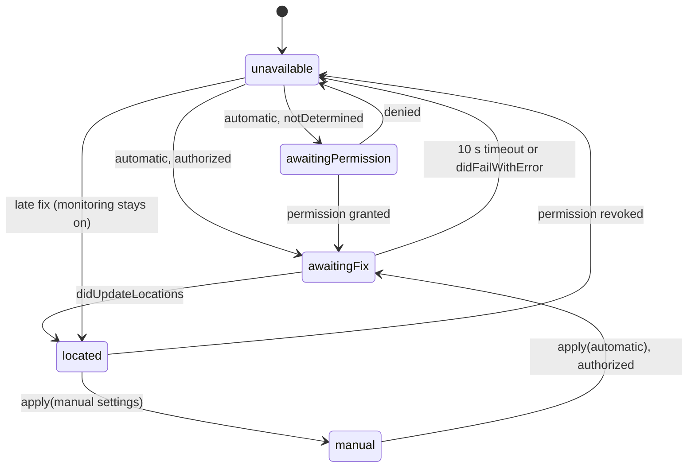

# Location

Covers: MeqatCore/Sources/MeqatCore/Location/, MeqatCore/Sources/MeqatCore/Settings/AppSettings.swift (LocationSettings, LocationMode), MeqatCore/Sources/MeqatCore/Settings/SettingsStore.swift, MeqatCore/Sources/MeqatCore/App/Composition.swift, Meqat/Settings/LocationPane.swift, Meqat/App/AppEnvironment.swift, Config/Meqat.entitlements, MeqatCore/Tests/MeqatCoreTests/{LocationProviderTests,ManualCityInputTests,SettingsTests,CompositionTests}.swift

Decides where prayer times are fetched for: the Mac's rounded location (automatic) or a typed city (manual). Conventions: [meqatcore-conventions](../guides/meqatcore-conventions.md), [app-conventions](../guides/app-conventions.md).

## Modes and settings

`LocationSettings` (`mode: LocationMode`, `manualCity`, `manualCountry`, `manualState`) is persisted by `SettingsStore` in `UserDefaults` key `settings.location` (versioned envelope, version 1). Default mode is `.automatic`.

- `SettingsStore.setLocationMode(.automatic)` resets to a bare `LocationSettings()` (manual fields dropped).
- `setLocationMode(.manual)` keeps any stored manual fields.
- `setManualLocation(city:country:state:)` sets manual mode with those fields.
- `LocationSettings.placeName(timeZone:)`: manual gives the city; automatic derives the last segment of the time zone id (underscores to spaces). It is not reverse geocoding.

## LocationProvider

`LocationProvider` (`Location/LocationProvider.swift`, `@MainActor @Observable`) wraps `CLLocationManager` behind `LocationManaging` (tests use a fake). Output: `state: LocationState`, `coordinates: Coordinates?`, `onChange` callback.

| `LocationState` | Meaning |
|---|---|
| `awaitingPermission` | status `notDetermined`; `requestWhenInUseAuthorization()` was called |
| `awaitingFix` | authorized, waiting for a first fix |
| `located(Coordinates)` | rounded fix available |
| `manual(city:country:state:)` | manual mode with city and country set |
| `unavailable` | denied/restricted, fix timed out or failed, or manual with empty city/country |

Rules:
- `apply(_:)` is called at launch and on every location-settings change. Manual: stops CoreLocation, clears in-memory fixes, state becomes `.manual` or `.unavailable`. Automatic: no-op if already automatic.
- Authorization is read through `handleAuthorization`: authorized (Always, WhenInUse or `.authorized`) begins a fix unless already `awaitingFix` or `located`; `notDetermined` requests permission; anything else (denied, restricted) is `unavailable` and stops monitoring.
- `beginFix()`: `requestLocation()` plus `startMonitoringSignificantLocationChanges()`, and a `fixTimeout` = 10 s timer that sets `unavailable` if still `awaitingFix`.
- `handleFailure()` only matters while `awaitingFix`; monitoring stays on, so a late fix still recovers.
- Throttle: a fix within `minUpdateInterval` = 2 h of the last accepted fix is ignored.
- `onChange` fires on the first accepted fix and afterwards only when the rounded fix moved more than `reportDistance` = 5 km from the last reported one. Smaller moves update `state` and `coordinates` silently.

## Privacy

- Coordinates are rounded to 2 decimals (about 1 km) at the source in `handleLocations` (`round2`), and again when the request is built (`%.2f` in `AladhanClient`). Raw fixes are never stored.
- Only rounded coordinates, or the typed city/country/state, go to `api.aladhan.com`, plus the cache copy in `timings.json` (see [prayer-times-sync](prayer-times-sync.md)).
- Switching modes forgets fixes in memory and strips the location from the cache (`SyncCoordinator.clearCachedLocation()`).
- Logs carry error kinds only. The usage-description strings (`INFOPLIST_KEY_NSLocationWhenInUseUsageDescription` in `Meqat.xcodeproj/project.pbxproj`) state the rounding and Aladhan-only use. Sandbox entitlements: `com.apple.security.personal-information.location` and `com.apple.security.network.client`.

## Manual city

`ManualCityInput.normalized(city:country:state:)` (`Location/ManualCityInput.swift`): trims whitespace/newlines, cuts each field to `maxLength` = 100 characters, returns nil if city or country is empty, an empty state becomes nil. Non-ASCII passes through.

`LocationPane` (`Meqat/Settings/LocationPane.swift`): radio group Automatic / Manual city; three text fields and a "Look up" button (also Return in a field) that is disabled while the normalized input is nil or a lookup is running. Commit calls `store.setManualLocation`. The status line follows `SettingsContext.lookupStatus`:
- `idle`, `lookingUp`, `found` (shows the committed place), `cityNotFound`, `unreachable`.
- Set by `AppEnvironment.startLookup()` (manual mode entered) and `updateLookup(_:)` from `SyncCoordinator.status`: `lastFailure` nil gives found, `.cityNotFound` gives city not found, `.network` gives unreachable.
- City validity is only known by the first sync: Aladhan returns HTTP 400, which becomes `AladhanError.cityNotFound` (no retry).
- Switching back to automatic clears the three fields.

## Feeding sync

`Composition.fetchParameters(location:settings:timeZone:)` maps `LocationState` to `FetchParameters`: `.located` gives coordinates, `.manual` gives a city, the other three states give nil, which makes the coordinator skip syncing. Method, school and `TimeZone.current.identifier` come from settings and the system.

Wiring in `Meqat/App/AppEnvironment.swift`:
- `provider.onChange` triggers `.locationChanged` and refreshes the UI.
- `settingsChanged`: a mode change calls `clearCachedLocation()`; a location change calls `provider.apply(...)`, and in manual mode `startLookup()`; then `.settingsChanged` (debounced 1 s).
- `onCacheReplaced`: drops a cache whose location belongs to the other mode (`Composition.isStale`).
- Menu: `MenuLocationInfo(LocationState)` maps `awaitingPermission`, `awaitingFix`, `available` (located or manual), `missing` (unavailable) for the dropdown prompts; "open location pane" action opens the settings pane.

## Gotchas

- `FetchParameters.current(...)` in `Sync/SyncPolicy.swift` is a second mapping used only by tests; the app uses `Composition.fetchParameters`.
- Denied permission shows `unavailable` with no timeout; there is no fallback to the last fix. Cached timings keep working until they run out.
- Manual mode with a city but empty country is `unavailable` (`testManualWithEmptyCountryIsUnavailable`).
- Tests: `LocationProviderTests` (permission, timeout, throttle, distance, rounding, mode switch), `ManualCityInputTests`, `CompositionTests.testFetchParameters`, `testMenuLocationInfoMapping`, `testIsStaleWhenCacheLocationBelongsToOtherMode`.
