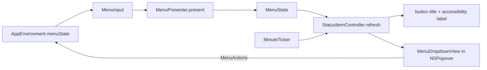

# Menu bar

Covers: MeqatCore/Sources/MeqatCore/Menu/, Meqat/MenuBar/, Meqat/App/AppEnvironment.swift, Meqat/Debug/MenuDebugHarness.swift, MeqatCore/Tests/MeqatCoreTests/MenuPresenterTests.swift

The status item title and the dropdown popover. All text and state logic is pure in MeqatCore; the app only renders it. Conventions: [meqatcore-conventions](../guides/meqatcore-conventions.md), [app-conventions](../guides/app-conventions.md). Inputs come from [events.md](events.md), [prayer-times-sync.md](prayer-times-sync.md), [location.md](location.md).

## MenuInput (no clock reads, no I/O)

`now`, `timeZone`, `events` (engine output for yesterday..day after tomorrow), `styles` (per-event `AlertStyle`), `place`, `hasScheduleForToday`, `sync: MenuSyncInfo`, `location: MenuLocationInfo`, `notificationsAuthorized`, `bannerNow`, `showsCouldntRefresh`, `updateNotice: UpdateNotice?` (version and release URL) and `checksForUpdates` (defaults `nil`, `true`). `AppEnvironment.menuState()` builds it; `MenuSyncInfo(SyncStatus)` and `MenuLocationInfo(LocationState)` map core state (in `App/Composition.swift`).

## Status title (first match wins)

| Condition | Title |
|---|---|
| inside a prohibited window (even if its alerts are disabled) | `⛔ Shuruq ends in 12m` |
| `bannerNow` set | `● Asr now` |
| a current non-disabled event exists | `☾ Dhuhr ends in 1h 11m` |
| a next non-disabled event exists | `☾ Asr in 1h 11m` |
| otherwise, or no schedule today | `☾` (label "Meqat") |

- Countdowns round down to whole minutes: `<1m`, `12m`, `1h 0m`. Spoken form goes to `statusAccessibilityLabel`.
- "Current" = valid event with `start <= now < end` whose style is not `.disabled`; if several overlap, the latest start wins. May be yesterday's Isha past midnight.
- "Next" = earliest valid event starting after `now` whose style is not `.disabled`; may be tomorrow's.
- `bannerNow` is set by `AppEnvironment.showBannerNow` when a banner fires but notifications are not authorized; it clears after 5 min (`bannerNowDuration`) or when the dropdown opens (`MenuActions.dropdownOpened`).

## Dropdown (`MenuDropdownView`, 280 pt wide)

- Header `Wed 28 Oct · Dhaka` (nil without today's schedule).
- Hero (`MenuHero`, nil without a current or next event): picked like the status title (prohibited window, even Disabled, then current, then next; `bannerNow` ignored).

| `kind` | `title` (view uppercases) | `countdownText` | `progress` | `startText` | `nextText` |
|---|---|---|---|---|---|
| `.forbidden` (red tint) | `Forbidden · Sunrise/Noon/Sunset` | `6m left` | 0…1 | window start | `Dhuhr 11:46` |
| `.current` | `Dhuhr` | `1h 11m left` | 0…1 | event start | `Asr 15:04` (nil if no next) |
| `.next` | `Next · Asr` | `1h 11m` | nil | next start | nil |

  VoiceOver: `Dhuhr, current, 1 hour 11 minutes left, next Asr at 15:04`; `Forbidden (noon), forbidden window, 6 minutes left, next Dhuhr at 11:46`; `Next, Forbidden (noon), in 4 hours 36 minutes, at 11:36`.
- Rows (`MenuRow`, one per non-prohibited event of today, so 7): marker `none/done/current/next` -> `""/✓/●/○`, `timeText` (`04:52`, `06:20–11:36` for Duha, `—` when invalid, `(prev. night)` suffix), VoiceOver label without countdown (`Dhuhr, current, 11:46`). A Tahajjud carried from last night replaces today's row from its start.
- Forbidden summary (`MenuForbiddenSummary`) under the rows: `Next forbidden 17:12–17:27` for today's earliest prohibited window still to start, whatever its style, else `No more forbidden windows today`; spoken `Next forbidden window, 17:12 to 17:27`.
- Empty state replaces rows when `hasScheduleForToday` is false (`MenuEmptyState`):

| State | Message | Button |
|---|---|---|
| `awaitingPermission` | Waiting for location permission… | Open Location settings |
| `fetching` | Fetching times… | none |
| `setLocation` | Set your location | Open Location settings |
| `cityNotFound` | City not found — check Location settings | Open Location settings |
| `offline` | No schedule — connect to the internet | Try again |

  Precedence: awaiting permission, then fetching (syncing or awaiting fix), then missing location, then last failure; no failure means fetching.
- "Notifications are off — Open System Settings" row when `!notificationsAuthorized` (opens the Notifications settings pane URL).
- `MenuState.updateRow` (`MenuUpdateRow`: `Update available — <x.y.z>` and the release URL) is set only when `updateNotice` is present and `checksForUpdates` is on, with or without a schedule. `MenuDropdownView` renders it as a link row above the footer divider (below the notifications-off row); clicking opens the URL and closes the popover via `dismiss`. Harness: `-MeqatDebugUpdate 1.4.0`.
- Footer text (first match): `Couldn't refresh`, `Syncing…`, `Offline — using cache from d MMM`, `Synced HH:mm` (today) or `Synced d MMM HH:mm`, empty. Times follow `MenuInput.timeFormat` (`h:mm a` when 12-hour). One line: status text, then ↻ (Refresh now, disabled while fetching) and ⚙ (Settings) icon buttons with matching tooltips and VoiceOver labels, then Quit.

## "Couldn't refresh"

`refreshNow()` sets `refreshPending` if a fetch started. When the observed `SyncStatus` stops fetching with a `lastFailure`, `showCouldntRefresh()` sets `showsCouldntRefresh` for 5 s (`couldntRefreshDuration`), then clears it.

## Actions (`MenuActions`, wired in `AppEnvironment.menuActions()`)

| Action | Effect |
|---|---|
| `refreshNow`, `tryAgain` | `coordinator.trigger(.refreshNow)` |
| `openSettings` | Settings window, General pane |
| `openLocationPane` | Settings window, Location pane |
| `dropdownOpened` | clears `bannerNow` |
| `quit` | `NSApp.terminate` |

## Refresh and ticker

- `StatusItemController.refresh()` re-reads state, sets title and accessibility label, swaps the popover root view and resizes it if shown. It is called on every observed change (`track()` over `coordinator.status`, `provider.state`, `scheduler.notificationsAuthorized`), settings change, and popover open.
- `MinuteTicker` fires 0.05 s after each wall-clock minute (tolerance 0.2 s) to update countdowns. `rearmTicker()` is called after wake, time zone change and clock change.

## Tests

`MenuPresenterTests`: next/rows, disabled Duha, prohibited precedence, crescent, countdown rounding, tomorrow after Isha, banner now, VoiceOver labels, invalid row, prev-night carry-over, empty-state precedence, footer variants, notifications row and place. `CompositionTests` covers the `MenuSyncInfo`/`MenuLocationInfo` mapping. The controller and views are untested; use the harness.

## Debug harness

`-MeqatDebugHarness Menu`: status item with a fixed mock day, clock starting at 13:52 and running on, Duha disabled, notifications off; actions print `action: <name>`. Add `-MeqatDebugEmpty offline` for the offline empty state, `-MeqatDebugNow 17:15` to start the clock at another time, `-MeqatDebugTimeFormat 12` for 12-hour times.
