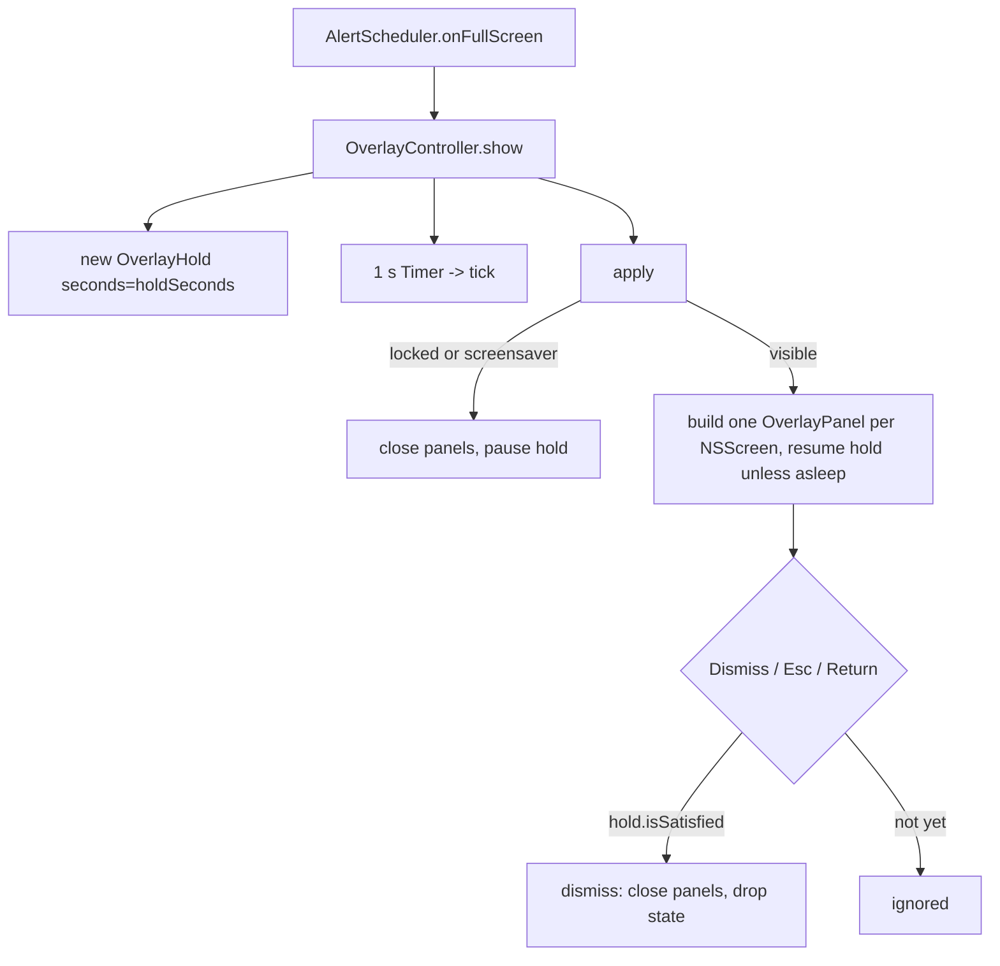

# Full-screen overlay

Covers: Meqat/Overlay/, MeqatCore/Sources/MeqatCore/Overlay/OverlayHold.swift, Meqat/Debug/OverlayDebugHarness.swift, MeqatCore/Tests/MeqatCoreTests/OverlayHoldTests.swift

The focus screen a `.fullScreen` alert opens. Triggered by [alerts.md](alerts.md); the hold time is set per event ([settings.md](settings.md)). Conventions: [app-conventions](../guides/app-conventions.md).

## Pieces

| Symbol | File | Role |
|---|---|---|
| `OverlayContent` | `Overlay/OverlayContent.swift` | `eventName`, `start`, `end`, `holdSeconds` |
| `OverlayController` | `Overlay/OverlayController.swift` | owns panels, hold, 1 s timer, lock/sleep state |
| `OverlayPanel` | `Overlay/OverlayPanel.swift` | borderless `NSPanel`, one per screen |
| `OverlayModel`, `OverlayView` | `Overlay/OverlayView.swift` | SwiftUI content; model shared by all panels |
| `OverlayHold` | `MeqatCore/Overlay/OverlayHold.swift` | pure hold countdown |

## Flow

## Hold (`OverlayHold`)

- `resume(at:)`/`pause(at:)` accumulate elapsed time; `remaining(at:)`, `isSatisfied(at:)` (remaining <= 0). `seconds` is clamped to >= 0; 0 means dismissable at once.
- The hold counts only while the overlay is visible and awake: it pauses on lock, screensaver and sleep (`apply()`).
- The Dismiss button is disabled until `model.remaining <= 0`; its title shows `Dismiss (m:ss)`. Esc (`OverlayPanel.cancelOperation` -> `onCancel`) and Return (`.keyboardShortcut(.defaultAction)`) both go through `dismissIfSatisfied`, so neither bypasses the hold.

## Window behaviour

- `OverlayPanel`: level `CGShieldingWindowLevel()`, `[.canJoinAllSpaces, .fullScreenAuxiliary, .stationary, .ignoresCycle]`, opaque black, `.nonactivatingPanel`, `hidesOnDeactivate = false`, frame = `screen.frame`. It can become key and main. This lets it sit over full-screen apps and every Space.
- Multi-display: `buildPanels()` makes one panel per `NSScreen.screens`; the first becomes key. On `NSApplication.didChangeScreenParametersNotification` the panels are closed and rebuilt.
- A second `show` while one is open replaces the content and restarts the hold on the same model (no second window set). The debug harness exercises this.
- Lock/screensaver: observes distributed notifications `com.apple.screenIsLocked/Unlocked`, `com.apple.screensaver.didstart/didstop`, and workspace will-sleep/did-wake. While locked or in screensaver, panels are closed and the hold paused; on unlock they are rebuilt and the hold resumes. If unlock happens after `content.end`, the overlay is dropped without being shown.
- Overlay does not persist: `dismiss()` clears content and model. Nothing is stored.

## Accessibility

- Announcements via `NSAccessibility.post(.announcementRequested)` at high priority: on show (`Dismiss available in N seconds`), every 10 s of remaining hold, and when the hold ends (`Dismiss is available`). Not posted while hidden or asleep.
- The event name has the header trait; the button title uses `.numericText()` transition only when Reduce Motion is off (`.identity` otherwise), and `.animation(nil, value: model.remaining)` stops other animation.
- Gradient background chosen for white-text contrast (see comment in `OverlayView`).

## Gotchas

- `OverlayController` is created in `AppEnvironment` as a stored property, so its observers live for the app lifetime.
- The hold timer's visible countdown comes from `OverlayHold`, not from counting ticks, so it stays correct across sleep.

## Tests

`OverlayHoldTests`: count down, paused time not counted, zero hold, repeated pause/resume. Controller, panel and view have no unit tests; verify with the harness.

## Debug harness

`-MeqatDebugHarness Overlay` (DEBUG; see `Meqat/Debug/DebugHarness.swift`): shows "Asr" after 3 s, then "Maghrib" at 23 s to test replacement. Hold is 10 s unless `-MeqatDebugHold <n>`.
