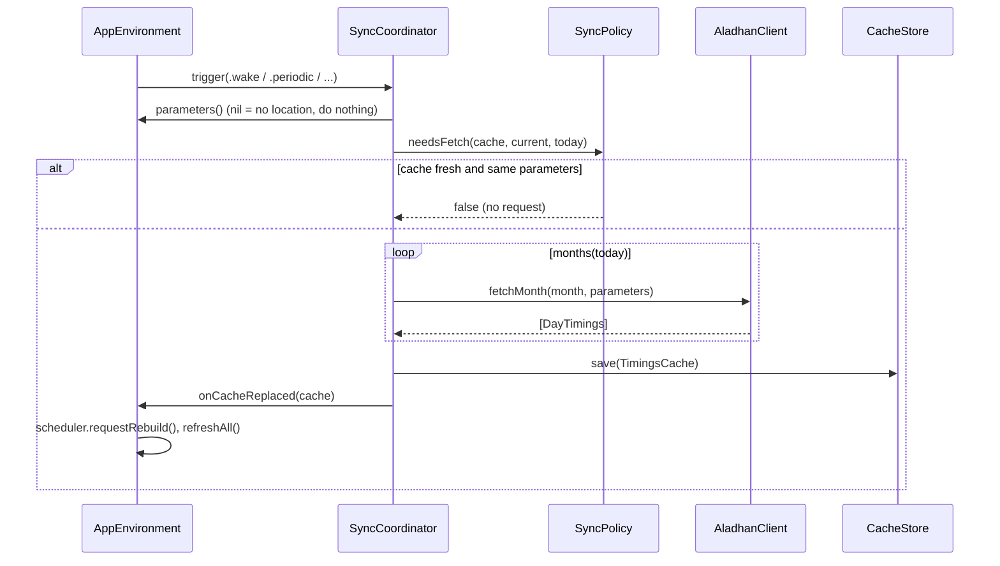
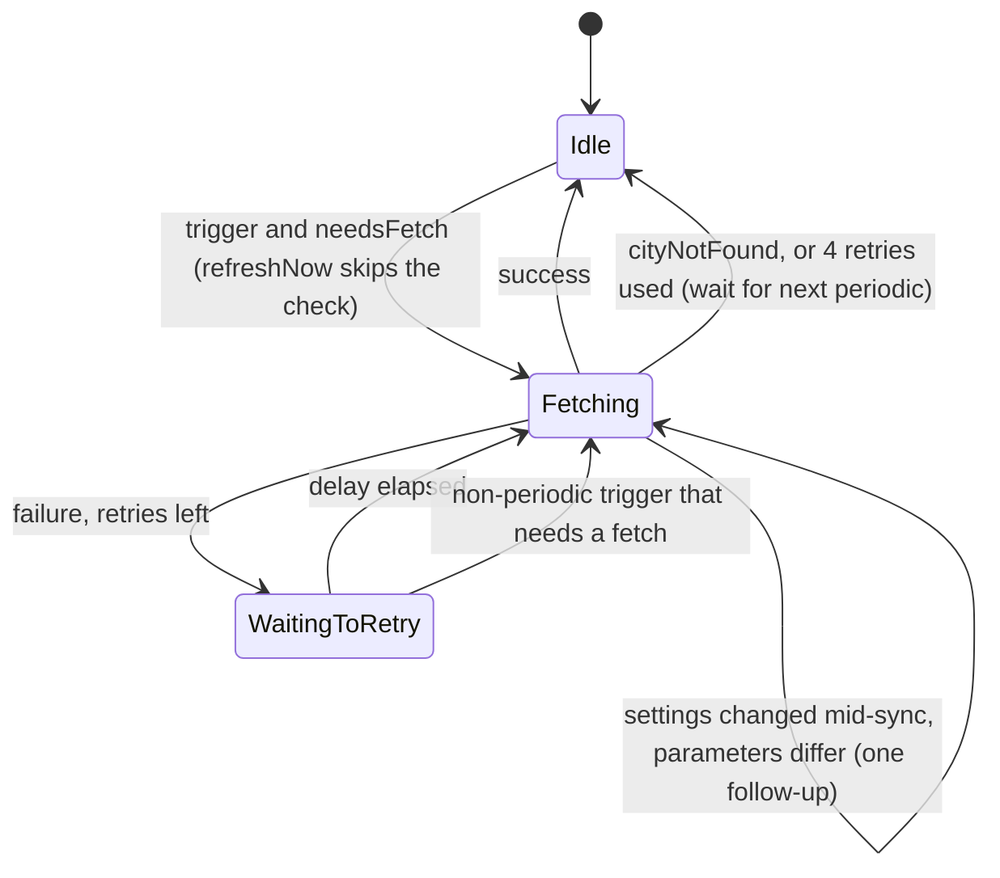

# Prayer-times sync

Covers: MeqatCore/Sources/MeqatCore/Aladhan/, MeqatCore/Sources/MeqatCore/Cache/, MeqatCore/Sources/MeqatCore/Sync/, MeqatCore/Sources/MeqatCore/App/Composition.swift, Meqat/App/AppEnvironment.swift, Meqat/App/SystemEvents.swift, MeqatCore/Tests/MeqatCoreTests/{AladhanClientTests,AladhanLiveTests,TimingsCacheTests,SyncPolicyTests,SyncCoordinatorTests,CompositionTests}.swift

Keeps a local cache of Aladhan prayer timings covering yesterday through today + 30 days. All logic is in MeqatCore; the app only fires triggers. Conventions: [meqatcore-conventions](../guides/meqatcore-conventions.md), [app-conventions](../guides/app-conventions.md).

## Flow

## Aladhan client

`AladhanClient` (`Aladhan/AladhanClient.swift`), protocol `AladhanFetching`, transport `HTTPTransport` (`URLSessionTransport` uses `URLSession.shared`; tests inject stubs from `MeqatCore/Tests/MeqatCoreTests/Support/StubAladhan.swift`).

| Item | Value |
|---|---|
| URL | `https://api.aladhan.com/v1/{calendar or calendarByCity}/{year}/{month}` |
| Coordinates | `calendar` with `latitude`, `longitude` rounded to 2 decimals (`%.2f`) |
| City | `calendarByCity` with `city`, `country`, optional `state` |
| Always sent | `school` (0 or 1), `iso8601=true` |
| `method` | only when `FetchParameters.method` is non-nil (nil = Aladhan default) |
| Encoding | own unreserved-set percent-encoding, so `& = +` in a city name stay inside one value |
| Timeout | 5 s per request (`request.timeoutInterval`) |
| Body cap | `maxBodyBytes` = 1 MiB, else `AladhanError.bodyTooLarge` |

Errors (`AladhanError`):
- `noLocation`: `parameters.location` is nil; thrown before any request.
- `cityNotFound`: HTTP 400 on the city endpoint only. Any other non-200 is `http(code)`.
- `apiCode(n)`: body `code` is not 200.
- `invalidResponse(reason)`: undecodable body, a date outside the requested month, a duplicate date, a malformed date, or a missing/unparseable timing.

Parsed per day (`DayTimings`): Fajr, Sunrise, Dhuhr, Asr, Sunset, Maghrib, Isha, Midnight, Lastthird, as absolute instants (iso8601 carries the offset). The date comes from `date.gregorian.date` ("DD-MM-YYYY"). A single bad day fails the whole month.

## Cache

`CacheStore` (`Cache/CacheStore.swift`) and `TimingsCache` (`Cache/TimingsCache.swift`).

- File: `timings.json` in `CacheStore.defaultDirectory()` = Application Support `/Meqat/` (inside the app sandbox container). The app falls back to the temporary directory if that lookup throws.
- Format: flat JSON, keys `formatVersion, timeZoneId, latitude, longitude, city, country, state, method, school, fetchedAt, days`. Unused location fields are explicit `null`; `days` sorted by date; instants are ISO 8601, `LocalDate` is `yyyy-MM-dd`.
- `TimingsCache.currentFormatVersion` = 1. `load()` deletes a corrupt file or a different version and returns nil.
- `save` writes atomically; a failed save keeps the old file (`testFailedSaveKeepsOldFile`).
- `strippingLocation()` nils the location but keeps days (used on a mode switch and for stale results).

## Sync policy

`SyncPolicy` (`Sync/SyncPolicy.swift`):
- `months(today:)`: every month from yesterday through today + 30 days (2 or 3 months, since the span is 32 days; late January needs 3).
- `needsFetch` is true when: no cache, or the cache does not cover yesterday..today+30, or the location changed, or method, school or `timeZoneId` changed.
- Location differs: coordinates move more than `moveThresholdMeters` = 5000; city/country/state differ; coordinate-vs-city or nil on either side always differs.

## Coordinator

`SyncCoordinator` (`Sync/SyncCoordinator.swift`, `@MainActor @Observable`). Public state: `status: SyncStatus` (`isFetching`, `isWaitingToRetry`, `lastSuccess`, `offlineSince`, `lastFailure: SyncFailure?` = `.cityNotFound` or `.network`) and `cache`. Loads the cache from disk in `init`.

Triggers (`SyncTrigger`): `periodic, wake, settingsChanged, locationChanged, timeZoneChanged, refreshNow`.

Rules in `handle(_:)`:
- `parameters()` nil: return (no location yet).
- A sync is running: if parameters differ from `runningParameters`, set `followUpPending` (one follow-up with the latest parameters); otherwise drop the trigger.
- Waiting to retry: `.periodic` is ignored; any other trigger cancels the wait.
- All triggers except `.refreshNow` must pass `needsFetch`.
- `.settingsChanged` is debounced 1 s (`debounce`) and then handled as `.locationChanged`.
- A sync fetches every month of `months(today:)`, merges days, and replaces the whole cache (all-or-nothing). Failure leaves the cache untouched.
- Failure: `cityNotFound` sets `lastFailure = .cityNotFound`, no retry. Everything else sets `.network` and `offlineSince` (kept from the first failure), then retries after `backoff` = 15 s, 30 s, 60 s, 300 s (5 attempts total). After that it gives up until the next periodic trigger. Any new accepted trigger resets the sequence.
- Success clears `offlineSince` and `lastFailure`, sets `lastSuccess`, calls `onCacheReplaced`.
- `clearCachedLocation()`: saves the stripped cache and publishes it.
- Logs only the error kind, never URLs, coordinates or place names.

## App triggers

In `Meqat/App/AppEnvironment.swift`:

| Source | Trigger |
|---|---|
| Launch (`start()`) | `.periodic` |
| `NSBackgroundActivityScheduler` `com.masnunsiam.Meqat.periodic`, every 2 h, 10 min tolerance | `.periodic` |
| `NSWorkspace.didWakeNotification` (`SystemEvents`) | `.wake` |
| `NSSystemTimeZoneDidChange` | `.timeZoneChanged` (after `NSTimeZone.resetSystemTimeZone()`) |
| Location settings, method or school changed (`store.onChange`) | `.settingsChanged` (debounced) |
| `LocationProvider.onChange` (first fix, move over 5 km) | `.locationChanged` |
| Menu "Refresh now" / "Try again" | `.refreshNow` |

There is no network-reachability trigger (no `NWPathMonitor`). Recovery from offline is via the backoff, wake, the 2 h periodic, or a manual refresh. A clock change only rebuilds alerts, no sync.

Fetch parameters come from `Composition.fetchParameters(location:settings:timeZone:)` (`.located` and `.manual` give a location; `.awaitingPermission`, `.awaitingFix`, `.unavailable` give nil). `FetchParameters.current(...)` in `SyncPolicy.swift` is a separate helper used only by tests.

After `onCacheReplaced`: if `Composition.isStale(cache, mode:)` (coordinates with manual mode, or city with automatic mode, from a sync that was in flight during a mode switch) the app calls `clearCachedLocation()`; then alerts rebuild and the UI refreshes. On mode change the app also calls `clearCachedLocation()` immediately.

UI side: `refreshNow` shows "couldn't refresh" for 5 s if the sync ends with a failure; the Location pane's lookup line maps `lastFailure` to found / city not found / unreachable (`updateLookup`).

## Gotchas

- Cache covers only the fetched window; the event engine needs yesterday for Tahajjud (see [events](events.md)).
- `timeZoneId` is part of the cache identity: a zone change refetches even with identical coordinates.
- `AladhanLiveTests` runs only with `MEQAT_LIVE_TESTS=1`.
- `SyncCoordinatorTests` use `ManualSleeper` (no real waiting); see `testFiveAttemptsWithBackoffAndCacheUntouched`, `testSettingsChangeDuringSyncQueuesOneFollowUp`, `testFiveSettingsChangesMakeOneSyncOneSecondAfterTheLast`.
