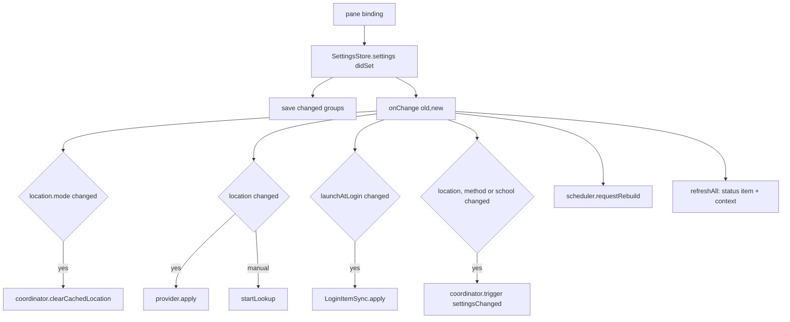

# Settings

Covers: MeqatCore/Sources/MeqatCore/Settings/, Meqat/Settings/, Meqat/App/AppEnvironment.swift, Meqat/Debug/SettingsDebugHarness.swift, MeqatCore/Tests/MeqatCoreTests/SettingsTests.swift, StaticTimeHintTests.swift

The settings model, its persistence, the settings window, and how a change reaches the rest of the app. Conventions: [meqatcore-conventions](../guides/meqatcore-conventions.md), [app-conventions](../guides/app-conventions.md). Related: [alerts.md](alerts.md), [location.md](location.md), [events.md](events.md), [launch-at-login.md](launch-at-login.md).

## Model (`Settings/AppSettings.swift`)

`AppSettings` = `general: GeneralSettings`, `location: LocationSettings`, `events: [EventID: EventSettings]`; `settings[event: id]` falls back to `EventSettings.defaults(for:)`.

| Group | Fields (default) |
|---|---|
| `GeneralSettings` | `launchAtLogin` (true), `method: Int?` (nil = automatic), `school: School` (`.shafii`; `.hanafi`), `timeFormat: TimeFormat` (`.twentyFour`; `.twelve`), `shuruqMinutes` (15), `istiwaMinutes` (10), `ghurubMinutes` (15) |
| `LocationSettings` | `mode: LocationMode` (`.automatic`/`.manual`), `manualCity`, `manualCountry`, `manualState` |
| `EventSettings` | `style`, `timeSource` (`.calculated`/`.fixed`), `staticTime: ClockTime?`, `startAlert`, `endAlert`, `preWarning`, `overlayHoldSeconds` (per-field defaults in [alerts.md](alerts.md)) |

Events: `EventID.allCases` = tahajjud, fajr, shuruq, duha, istiwa, dhuhr, jumah, asr, ghurub, maghrib, isha. Default style is `.banner`, except `.disabled` for duha and tahajjud.

Bounds (`Bounds`): offset -60...60, lead 1...120, hold 0...300, window minutes 5...30. `Bounds.clamped` is applied in every `init`, every `didSet`, and on decode, so out-of-range values never persist or leak.

A `.fixed` source with no `staticTime` behaves as calculated.

## Persistence (`SettingsStore`, `@MainActor @Observable`)

- UserDefaults keys `settings.general`, `settings.location`, `settings.events`. Each value is JSON in an `Envelope {version, value}`; `SettingsStore.version` = 1. A different version, or undecodable data, yields that group's defaults.
- Decoding is tolerant: a missing key takes the default for that event/field (`EventSettings.init(from:id:)`, `LeadAlert.init(from:defaults:)`, `EventsGroup`).
- `settings` is the single mutable property. Its `didSet` saves only the groups that changed, then calls `onChange(old, new)`. Setting an equal value does nothing.
- Helpers: `resetEvent(_:)`, `resetAll()` (General and every event; location kept), `setLocationMode(_:)` (to `.automatic` clears the manual city), `setManualLocation(city:country:state:)`.

## Window (`Meqat/Settings/`)

| File | Role |
|---|---|
| `SettingsWindowController` | `.shared`; `show(pane:)` selects a pane and opens the 680x480 "Meqat Settings" window (created once, reused). `store` must be set first. |
| `SettingsView` | `NavigationSplitView`: General, Location, then one row per event (prohibited events get a ⛔). `SettingsNavigation.selection` is a `SettingsPane` |
| `SettingsContext` | runtime data panes show, not settings: `calculatedWindows`, `lookupStatus`, `place`, `coordinatesText`, `lastSyncText` |
| `GeneralPane` | Launch at login; Calculation method (`CalculationMethod.all`); Asr school; Time format; three prohibited-window durations; Full-Screen overlay timeout; Test alerts ("Show test overlay", "Send test banner", with a note when notifications are off); "Reset all settings…" with confirmation |
| `LocationPane` | Automatic/Manual radio; manual City/Country/State fields normalized by `ManualCityInput`; "Look up" calls `setManualLocation`; shows `lookupStatus` and last sync |
| `EventPane` | Time source (Calculated/Static + time picker), Style, Start alert (offset), End alert, Pre-warning, Overlay minimum hold, Reset to defaults |

- Panes bind straight to `store.settings.*`; the number fields clamp to the same `Bounds` as the model.
- Static time: choosing Static with no time seeds today's calculated start (floored to the minute) or 12:00. A warning shows when the static time is outside the calculated window (`StaticTimeHint.isOutside`, needs `context.calculatedWindows`).
- Minimum hold is disabled unless the style is Full-Screen Focus.
- `lookupStatus` (`idle, lookingUp, found, cityNotFound, unreachable`) is driven by `AppEnvironment.updateLookup` from `SyncStatus` after a manual city is set. "Look up" is disabled while looking up or when the input does not normalize.
- `refreshContext()` refills `SettingsContext` on every refresh and before opening the window.

## Propagation (`AppEnvironment.settingsChanged(old, new)`)

- Alert and window-length changes need no sync: the rebuild re-plans from the cached timings.
- Every change triggers `scheduler.requestRebuild()` and `refreshAll()`.

## Gotchas

- Menu and alerts read `store.settings` at call time; nothing caches a copy.
- `resetAll()` keeps the location on purpose.
- Adding a setting: give it a default in its `init(from:)`, bound it with `Bounds` if numeric, and decide what `settingsChanged` must do.

## Tests

`SettingsTests`: event order, defaults, missing keys, partial lead alert, unknown version, clamping via init/setter/decoding, round trip, resets, mode switch, `onChange`, place name, `ClockTime` coding. `StaticTimeHintTests`: the outside-window hint. Panes have no unit tests.

## Debug harness

`-MeqatDebugHarness Settings`: opens the window on the real store with mock context. Extra args: `-MeqatDebugPane <location|eventID>`, `-MeqatDebugWindows 1` (mock calculated windows), `-MeqatDebugLookup <idle|lookingUp|found|cityNotFound|unreachable>`.
