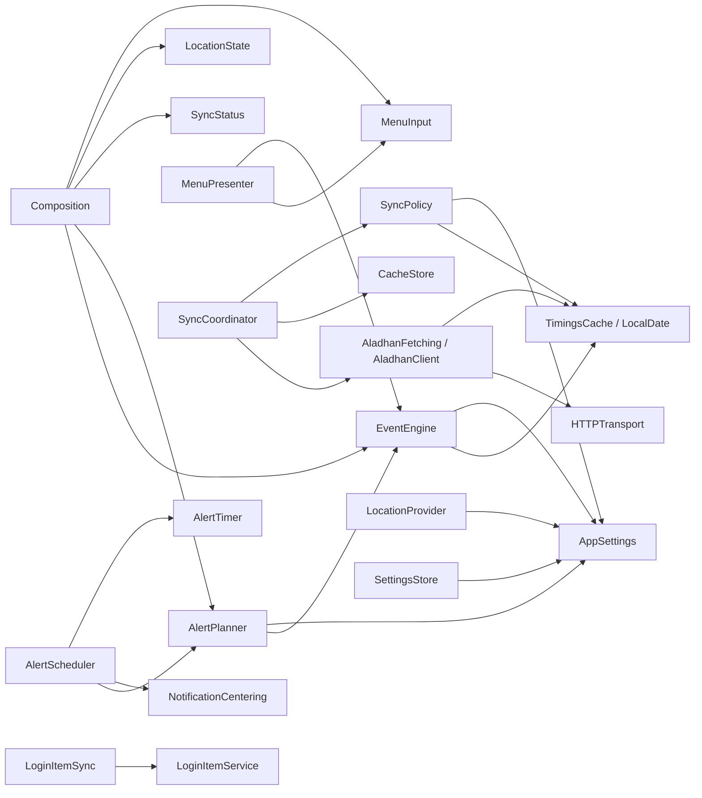

# MeqatCore

Covers: MeqatCore/

Swift package (`MeqatCore/Package.swift`, tools 5.9, macOS 14, one library product `MeqatCore`) holding all logic. No UI. Rules live in [guides/meqatcore-conventions.md](guides/meqatcore-conventions.md); the app side is in [app.md](app.md).

## Sources

All under `MeqatCore/Sources/MeqatCore/`.

| Folder / file | Main public types | Role |
|---|---|---|
| `MeqatCore.swift` | `MeqatCore` (enum) | `bundleIdentifier` constant, used as the `os.Logger` subsystem. |
| `Aladhan/AladhanClient.swift` | `AladhanFetching`, `AladhanClient` | Fetches one month of timings from the Aladhan API. |
| `Aladhan/AladhanError.swift` | `AladhanError` | `noLocation`, `cityNotFound`, `http(code)` and other fetch failures. |
| `Aladhan/HTTPTransport.swift` | `HTTPTransport`, `URLSessionTransport` | Network seam, stubbed in tests. |
| `Alerts/AlertPlanner.swift` | `AlertPlanner`, `PlannedAlert`, `AlertKind` | Pure: events + settings -> alerts inside a 48 h horizon, max 60 banners. |
| `Alerts/AlertScheduler.swift` | `AlertScheduler` | Rebuilds pending notifications, fires full-screen alerts (`onFullScreen`, `onBannerFired`). |
| `Alerts/AlertTimer.swift` | `AlertTimer`, `DispatchAlertTimer` | Timer seam for full-screen alerts. |
| `Alerts/NotificationCentering.swift` | `NotificationCentering` (+ `UNUserNotificationCenter` conformance) | Notification-center seam. |
| `App/Composition.swift` | `Composition`; `MenuSyncInfo.init(_: SyncStatus)`, `MenuLocationInfo.init(_: LocationState)` | Glue: `events`, `plan`, `fetchParameters`, `isStale`. |
| `Cache/CacheStore.swift` | `CacheStore` | Loads, saves and deletes the `TimingsCache` file. |
| `Cache/LocalDate.swift` | `LocalDate`, `YearMonth` | Calendar-day value types, independent of `Date`. |
| `Cache/TimingsCache.swift` | `TimingsCache`, `DayTimings`, `Coordinates`, `FetchLocation`, `FetchParameters` | Cached month data and the parameters it was fetched with. |
| `Engine/EventEngine.swift` | `EventEngine` | Pure: day timings + settings -> `[ScheduledEvent]`. |
| `Engine/ScheduledEvent.swift` | `ScheduledEvent` | One event on one date, with its effective and calculated interval. |
| `Location/LocationProvider.swift` | `LocationProvider`, `LocationState`, `LocationManaging` | CoreLocation wrapper; throttled, rounded fixes. |
| `Location/ManualCityInput.swift` | `ManualCityInput` | Validates and normalizes the manual city fields. |
| `LoginItem/LoginItemSync.swift` | `LoginItemService`, `MainAppLoginItem`, `LoginItemSync` | Applies `launchAtLogin` through `SMAppService`. |
| `Menu/MenuInput.swift` | `MenuInput`, `MenuSyncInfo`, `MenuLocationInfo`, `MenuFailure` | Everything the presenter needs, as plain values. |
| `Menu/MenuPresenter.swift` | `MenuPresenter` | Pure: `present(MenuInput) -> MenuState`. |
| `Menu/MenuState.swift` | `MenuState`, `MenuHero`, `MenuHeroKind`, `MenuForbiddenSummary`, `MenuRow`, `MenuRowMarker`, `MenuEmptyState`, `MenuEmptyAction` | What the dropdown and status title render. |
| `Overlay/OverlayHold.swift` | `OverlayHold` | Countdown logic for the overlay's hold time. |
| `Settings/AppSettings.swift` | `AppSettings`, `GeneralSettings`, `LocationSettings`, `EventSettings`, `StartAlert`, `LeadAlert`, `AlertStyle`, `TimeSource`, `School`, `LocationMode`, `Bounds` | Settings model, Codable with defaults. |
| `Settings/CalculationMethod.swift` | `CalculationMethod` | Static list of 23 Aladhan methods. |
| `Settings/ClockTime.swift` | `ClockTime` | Hour/minute value for static event times. |
| `Settings/EventID.swift` | `EventID`, `EventKind` | The fixed set of events (`allCases`), display names and kinds. |
| `Settings/SettingsStore.swift` | `SettingsStore` | `@Observable` UserDefaults-backed store, `onChange(old, new)`. |
| `Settings/StaticTimeHint.swift` | `StaticTimeHint` | Whether a static time falls outside the calculated window. |
| `Sync/SyncCoordinator.swift` | `SyncCoordinator`, `SyncTrigger` | Fetch orchestration: debounce, backoff, cache replace. |
| `Sync/SyncPolicy.swift` | `SyncPolicy`; `FetchParameters.current(...)` | Pure: when to refetch and which months. |
| `Sync/SyncStatus.swift` | `SyncStatus`, `SyncFailure` | Observable sync state. |

## API the app uses

| Group | Types |
|---|---|
| Composition | `Composition`, `MenuSyncInfo`, `MenuLocationInfo` |
| Settings | `SettingsStore`, `AppSettings` (+ sub-settings), `EventID`, `EventKind`, `CalculationMethod`, `ManualCityInput`, `StaticTimeHint`, `ClockTime`, `LocationMode` |
| Sync + cache | `SyncCoordinator`, `SyncTrigger`, `SyncStatus`, `SyncFailure`, `AladhanClient`, `CacheStore`, `TimingsCache`, `LocalDate` |
| Location | `LocationProvider`, `LocationState`, `Coordinates` |
| Alerts | `AlertScheduler`, `DispatchAlertTimer`, `PlannedAlert` (UNUserNotificationCenter passes as `NotificationCentering`) |
| Menu | `MenuPresenter`, `MenuInput`, `MenuState`, `MenuRow` (and related) |
| Overlay | `OverlayHold` |
| Login item | `MainAppLoginItem`, `LoginItemSync` |
| Misc | `MeqatCore.bundleIdentifier` |

## Dependencies

Arrows mean "uses". Settings and Cache are the shared base.

`AlertScheduler` and `SyncCoordinator` take closures (`plan`, `parameters`) instead of the stores, so the app injects `Composition` calls and the package never reaches into the app.

## Tests

`MeqatCore/Tests/MeqatCoreTests/`. Run with `swift test` in `MeqatCore/` (see [development.md](development.md)).

| Test file | Covers |
|---|---|
| `AladhanClientTests` | Request URLs, parsing, 400/HTTP errors, via `StubTransport` and `aladhan/` fixtures. |
| `AladhanLiveTests` | One real API call; skipped unless `MEQAT_LIVE_TESTS=1`. |
| `AlertPlannerTests` | `AlertPlanner` horizon, lead/start alerts, banner cap. |
| `AlertSchedulerTests` | `AlertScheduler` rebuilds, firing, suspend; defines `FakeNotificationCenter`, `FakeAlertTimer`. |
| `CalculationMethodTests` | Method ids unique, 23 entries, no 6 or 99. |
| `CompositionTests` | `Composition` events, plan, fetch parameters, staleness. |
| `EventEngineTests` | `EventEngine` event windows from `engine/` fixtures (DST, high latitude, after-midnight Isha, last third). |
| `LocationProviderTests` | `LocationProvider` states, throttling, timeout, with fake manager and clock. |
| `LoginItemSyncTests` | `LoginItemSync.apply` with `FakeLoginItem`. |
| `ManualCityInputTests` | `ManualCityInput.normalized`. |
| `MenuPresenterTests` | `MenuPresenter` rows, markers, empty states, status title. |
| `OverlayHoldTests` | `OverlayHold` remaining and satisfied. |
| `SettingsTests` | `AppSettings` coding and defaults, `SettingsStore`. |
| `SmokeTests` | `MeqatCore.bundleIdentifier`. |
| `StaticTimeHintTests` | `StaticTimeHint.isOutside` (Swift Testing `@Suite`). |
| `SyncCoordinatorTests` | `SyncCoordinator` triggers, retry/backoff, status, cache replace. |
| `SyncPolicyTests` | `SyncPolicy.needsFetch`, `months`, move threshold. |
| `TimingsCacheTests` | `TimingsCache`/`CacheStore` coding and persistence. |

Descriptions are summarized from test names and imports, not every assertion.

**Fixtures** (`Fixtures/`, copied into the test bundle as a resource):

| Path | Used by |
|---|---|
| `aladhan/calendar-dhaka-2026-10.json` | `AladhanClientTests` (successful month) |
| `aladhan/calendarByCity-400.json` | `AladhanClientTests` (city not found) |
| `engine/dhaka-2026-10-28-30.json` | `CompositionTests`, `AlertSchedulerTests` (a `TimingsCache`) |
| `engine/high-latitude.json`, `isha-after-midnight.json`, `lastthird-27-28-oct.json`, `new-york-2026-03-08.json` | `EventEngineTests`, loaded by name |

**Support/** helpers:

| File | Provides |
|---|---|
| `Fixture.swift` | `Fixture.data("path/name.json")` from `Bundle.module`. |
| `ManualSleeper.swift` | `ManualSleeper` actor, a fake clock advanced with `advance(by:)`. |
| `StubAladhan.swift` | `StubAladhan` actor implementing `AladhanFetching`, records `calls`. |
