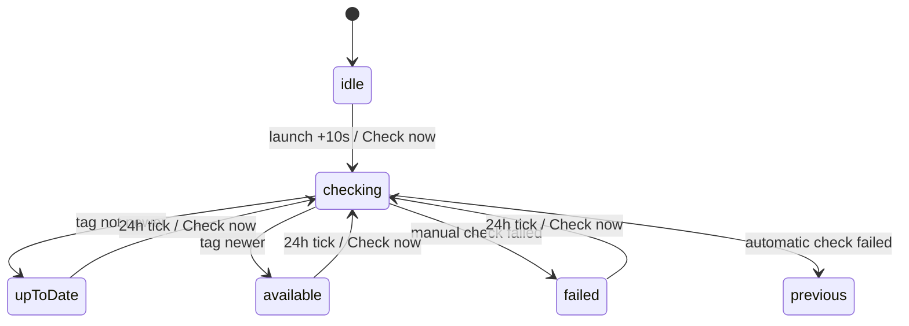

# PRD — About pane and update notice

**Status:** Approved · **Date:** 2026-10-30 · **Slug:** `about-and-updates` · **Owner:** Masnun Siam · **Priority:** medium · **Repo:** masnun-siam/meqat

This document is the source of truth for the feature: every issue is derived from it, and a decision that is not written here has not been made.

## Overview

An "About" pane in the Settings window shows the installed version, links to the GitHub repository, the author's GitHub profile and a Buy Me a Coffee page. Meqat also checks GitHub once a day for a newer release and, when there is one, says so in the menu dropdown and in About, with a link to the release page.

Today:
- The Settings window is a sidebar and detail window: General, Location, then one row per event.
- The version (1.3.0, build 4) is set in the Xcode project and is not shown anywhere in the app.
- Releases are published as GitHub Releases tagged `v<x.y.z>` with an unsigned DMG, and through the Homebrew cask `masnun-siam/tap/meqat`.
- The app's only network traffic is the Aladhan sync. It has the sandbox network-client entitlement and a shared HTTP transport with a 5-second request timeout pattern.
- There is no update check. The main PRD rules out an in-app auto-updater; this feature only tells the user, it never downloads or installs.

## Problem

Users who installed from the DMG never learn that a new version exists, so they keep running old builds with fixed bugs. Users also have no way to see which version they run, find the source, or support the author.

## Users

Every Meqat user, on their own Mac. There are no roles or accounts.

## Goals

- I can see which version of Meqat I am running.
- I find out within a day when a newer release is published, without leaving the menu.
- I can reach the source code, the author and a way to support the project in one click.
- I can turn the automatic check off.

## Non-goals

- Downloading, installing or replacing the app (no Sparkle or similar). The main PRD's non-goal stands.
- A system notification banner for updates. The notice lives only in the menu dropdown and the About pane.
- Pre-release or draft builds. Only GitHub's "latest" (non-prerelease, non-draft) release counts.
- Release notes inside the app. The release page shows them.
- Showing the author's email or personal website.
- Remembering a "skip this version" choice.
- Sending any data about the user or the Mac in the update request (no version, no identifier, no location).

## Requirements

- **FR-1 About pane.** The Settings sidebar gets an "About" row directly below "Location". The pane shows the app icon, "Meqat", "Version <marketing version> (<build>)" read from the running app's bundle, the update status (FR-4), a "Check now" button, a "Check for updates automatically" toggle, and three links that open in the default browser:
  - "GitHub repository" → `https://github.com/masnun-siam/meqat`
  - "Made by Masnun Siam" → `https://github.com/masnun-siam`
  - "Buy me a coffee" → `https://buymeacoffee.com/msiamn`
  - Acceptance: with 1.3.0 build 4 installed, About is the third sidebar row, shows "Version 1.3.0 (4)", and each link opens the URL above in the browser.

- **FR-2 Automatic check.** When the toggle is on (the default), Meqat asks GitHub for the latest release about 10 seconds after launch and then every 24 hours while running. The request carries no user data. When the toggle is off, no automatic request is made. Turning the toggle on starts a check at once.
  - Acceptance: with a network monitor, launching the app makes exactly one request to `api.github.com` within 15 seconds, with no query string and a `User-Agent` of `Meqat`; with the toggle off, relaunching makes none; switching it back on makes one at once.

- **FR-3 Manual check.** "Check now" runs a check immediately, whatever the toggle. While it runs, the button is disabled and the status reads "Checking…".
  - Acceptance: with the toggle off, clicking "Check now" makes one request and the status changes from "Checking…" to a result.

- **FR-4 Update status.** The About pane shows one of:
  - nothing yet checked: no status line;
  - "Checking…";
  - "You're up to date" with "Last checked <time>" (time in the user's time format setting);
  - "Version <x.y.z> is available" with a "View release" link to that release's page and, below it, "Installed with Homebrew? Run `brew upgrade --cask meqat`";
  - "Couldn't check for updates", only after a failed manual check.
  - A version is newer only if its `major.minor.patch` is numerically greater than the installed one (1.10.0 > 1.9.0). A leading `v` is ignored. A tag that is not `x.y.z` is treated as "no update".
  - Acceptance: with GitHub returning `v1.4.0` and 1.3.0 installed, About shows "Version 1.4.0 is available"; with `v1.3.0` it shows "You're up to date"; with `v1.10.0` against an installed 1.9.0 it shows an update; with `nightly` it shows "You're up to date".

- **FR-5 Menu notice.** While a newer version is known and the toggle is on, the menu dropdown shows "Update available — <x.y.z>" as a link row just above the footer. Clicking it opens that release's page and closes the dropdown. Otherwise the row is absent.
  - Acceptance: with GitHub returning `v1.4.0` and 1.3.0 installed, the dropdown shows "Update available — 1.4.0", and clicking it opens `https://github.com/masnun-siam/meqat/releases/tag/v1.4.0`; turning the toggle off removes the row.

- **FR-6 Failure.** A failed automatic check (offline, timeout, non-200, rate limit, bad JSON) changes nothing on screen and keeps the previous result; the next attempt is the next 24-hour tick. A failed manual check shows "Couldn't check for updates" until the next check. Prayer-time sync and alerts are never affected.
  - Acceptance: with the network off, the automatic check leaves About and the menu as they were; "Check now" then shows "Couldn't check for updates"; the prayer schedule keeps updating.

## Edge cases

- **Concurrency.** A check started while another is running does not start a second request; it waits for the running one's result. The toggle turned off during a check lets that check finish but shows nothing in the menu.
- **Sleep.** The 24-hour timer counts wall time; after waking past its due time the check runs once, not once per missed day.
- **Empty state.** Before the first result, About shows no status line and the menu shows no row.
- **Installed version newer than GitHub** (a local build): "You're up to date".
- **Rate limit.** Unauthenticated GitHub allows 60 requests an hour per IP; Meqat uses about one a day plus manual checks, so a 403/429 is handled as a normal failure.
- **Existing data.** None to migrate. The new toggle is a new field in the General settings group; a stored group without it decodes with the default (on). "Reset all settings" turns it back on.
- **Data isolation.** Single-user local app; no data leaves the Mac except the anonymous GitHub request.

## Technical design

### Data (FR-2)

- New field `checkForUpdates: Bool` (default `true`) in the General settings group, persisted in UserDefaults with the existing versioned envelope; tolerant decoding means no version bump.
- The latest check result lives in memory only. It is not persisted: a check runs shortly after every launch, so a stored result would add state without benefit.

### API (FR-2, FR-3)

Meqat calls GitHub's public API, unauthenticated:

- `GET https://api.github.com/repos/masnun-siam/meqat/releases/latest`
- Headers: `Accept: application/vnd.github+json`, `User-Agent: Meqat`. No other headers, no query string.
- Timeout: 5 seconds, matching the Aladhan requests. No retries beyond the next scheduled tick.
- Fields read from a 200 response: `tag_name` (string, e.g. `v1.4.0`) and `html_url` (the release page). Everything else is ignored. Any other status, a timeout or a body without these two strings is a failure.
- The endpoint already excludes drafts and pre-releases.

### Backend (MeqatCore)

- **Update checker** (FR-2–FR-6): fetches the endpoint through the existing HTTP transport abstraction (so tests inject a fake), parses the two fields, compares versions and produces a status. It holds a single in-flight check; concurrent callers share its result.
- **Status** values: `idle`, `checking`, `upToDate(checkedAt)`, `available(version, releaseURL)`, `failed`. A failure from an automatic check keeps the previous status; from a manual check it becomes `failed`.
- **Version comparison**: `x.y.z` numeric compare after removing a leading `v`; anything else is not newer.
- **Schedule**: first automatic check 10 seconds after launch, then every 24 hours, using an in-app timer; on wake, an overdue check runs once. Only runs while the toggle is on.
- The menu presenter gains an optional update notice (version and URL) so the "Update available" row is decided and tested in MeqatCore like the other menu rows.


*Lifecycle of the update status. "previous" means the status before the check is restored.*

### Frontend (app)

- **Settings sidebar** (FR-1): "About" row after "Location".
- **About pane** (FR-1, FR-3, FR-4): layout below; links open with the system browser. "Check now" is disabled while `checking`.

```
┌──────────────────────────────────────┐
│               ☾ (icon)               │
│                Meqat                 │
│          Version 1.3.0 (4)           │
│                                      │
│  Version 1.4.0 is available          │
│  View release ↗                      │
│  Installed with Homebrew? Run        │
│  brew upgrade --cask meqat           │
│  [Check now]                         │
│  ☑ Check for updates automatically   │
│                                      │
│  GitHub repository ↗                 │
│  Made by Masnun Siam ↗               │
│  ☕ Buy me a coffee ↗                 │
└──────────────────────────────────────┘
```
*About pane with an update available.*

- **Menu dropdown** (FR-5): the "Update available — x.y.z" link row sits between the event list (or notifications row) and the footer.
- The app wires the checker: starts the schedule at launch, restarts or stops it when the toggle changes, and refreshes the menu and About when the status changes.

### Realtime and other services

Not affected. GitHub is read-only; no other service is involved.

### Non-functional

- One request of a few KB a day; no effect on launch time (the first check is deferred 10 s).
- Privacy: the request sends no version, identifier or location. The main PRD's "no telemetry" holds.
- Sandbox: the existing network-client entitlement covers it; no new entitlement.
- No third-party dependency.

### Testing

- **Unit (MeqatCore, fake transport)**: version comparison (FR-4 cases incl. `v` prefix, 1.10.0 vs 1.9.0, non-semver tag, installed newer); response parsing (valid, missing fields, non-200, malformed JSON); status transitions for automatic vs manual failure (FR-6); single in-flight check (concurrency); the request has the exact URL and headers (FR-2); settings decode without the new field defaults to on; menu presenter shows the notice only when available and enabled (FR-5).
- **Live (`make test-live`)**: one test that the real endpoint returns a parseable `tag_name` and `html_url`.
- **Manual (release checklist)**: About layout and links (FR-1), toggle on/off network behaviour (FR-2), menu row click (FR-5), offline behaviour (FR-6).

## Rollout and cost

Everyone at once in the next release. No cost. Users on versions before this one will not be told about it; they find it through Homebrew or the GitHub page. Releases must keep the `v<x.y.z>` tag format and must not be marked pre-release, or the check will not see them.

## Success metrics

None formally defined. Meqat has no telemetry.

## Epics

- **E1 About pane and update notice** — covers FR-1 to FR-6. Issue: #78

## Decisions

- Daily GitHub check plus a menu row and About status, no system banner. — Fits the no-telemetry and no-auto-updater rules; one cheap request a day; no prayer-alert noise in Notification Center.
- "Update available" opens the GitHub release page, and About shows the `brew upgrade --cask meqat` hint. — No download or install code; correct for both DMG and Homebrew users.
- An on-by-default "Check for updates automatically" toggle in About. — It is the app's only non-Aladhan network call, so the user can turn it off.
- About is a sidebar row below Location. — Reuses the existing sidebar and detail window; no new window.
- Buy Me a Coffee link is `https://buymeacoffee.com/msiamn`. — Given by the owner.
- About shows the author's name and GitHub profile only. — Owner's choice; no email or website.
- Automatic-check failures are silent; only a failed manual check shows an error. — Updates are non-essential; offline users should not see errors for them.
- Priority medium. — Useful for DMG users, nothing broken today.
- One epic. — The feature is small and ships as one release.
- Unauthenticated request with `User-Agent: Meqat` and no version. — GitHub requires a user agent; sending the version would be a usage signal, which the no-telemetry rule forbids.
- Check result kept in memory, not persisted. — A check runs 10 s after every launch, so stored state adds nothing.
- Only `x.y.z` tags from GitHub's "latest" release count. — Matches the release script, which requires `MARKETING_VERSION` to be `x.y.z` and tags `v<version>`.

## Open questions

None.

## Change log

## Related

- Main PRD: `docs/prds/meqat.md` (non-goals: no auto-updater, no telemetry).
- Release steps: `docs/release-checklist.md`.
