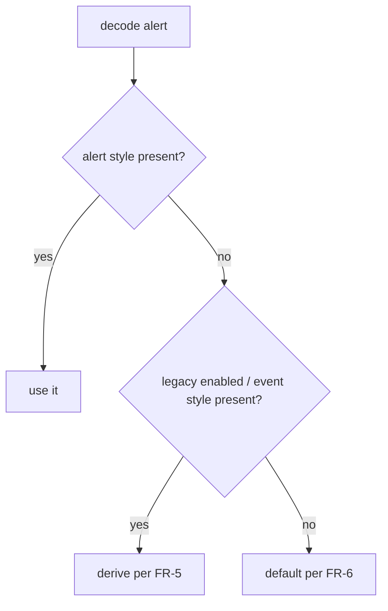

# PRD — Alert style per alert

**Status:** Approved · **Date:** 2026-11-07 · **Slug:** `alert-styles-per-alert` · **Owner:** Masnun Siam · **Priority:** medium · **Repo:** masnun-siam/meqat

Status is `Draft`, `In review` or `Approved`. This document is the source of truth for the feature: the tasks and every issue are derived from it, and a decision that is not written here has not been made.

## Overview

Each event (Fajr, Dhuhr, Asr, the prohibited windows and so on) can raise up to three alerts: at the start, before the end, and a pre-warning before the start. This feature lets the user pick the style of each of those alerts separately, so Fajr can open the full-screen overlay when it starts and only show a banner before it ends.

Today:
- Each event has one Style setting (Full-Screen Focus, Banner, Disabled) and three alerts, each with an Enabled toggle and a lead or offset in minutes.
- The start and end alerts both use the event's Style. The pre-warning is always a banner, even for a Full-Screen event.
- Disabled turns off every alert of the event and hides it from the menu's current and next rows.
- A full-screen overlay shows the event name and its window, the same for every kind of alert.
- Defaults: Banner for every event except Duha and Tahajjud (Disabled); start alert on with offset 0; end alert off, 15 min; pre-warning off, 20 min.

## Problem

The user wants the moment a prayer begins to take over the screen, but a reminder that its time is running out to be a quiet banner (or the reverse). With one style per event, choosing Full-Screen for the start forces Full-Screen for the end as well, and a pre-warning can never be full-screen.

## Users

Every Meqat user, on their own Mac. There are no roles or accounts; settings are local to the user.

## Goals

- I can choose Full-Screen, Banner or Off for each alert of each event on its own.
- Upgrading changes nothing about the alerts I already get.
- A full-screen overlay tells me which alert it is.

## Non-goals

- A sound choice, or any other per-alert option beyond style, lead and offset.
- More than three alerts per event, or several alerts of the same kind.
- A global "apply this style to every event" control.
- A way to keep a lead or offset value "remembered" with a separate on/off switch; Off is a style, and the lead or offset stays stored while Off.
- Changes to the overlay's hold, timeout, look or dismissal.
- Changes to the General pane's test alerts.

## Requirements

- **FR-1 Style per alert.** In each event's settings pane, the Start alert, End alert and Pre-warning sections each have a Style picker with Full-Screen Focus, Banner and Off. It replaces both the event-level Style picker and each section's Enabled toggle. The offset or lead field stays in each section and is editable whatever the style.
  - Acceptance: open Fajr's settings; there is no event-level Style picker and no Enabled toggle; set Start to Full-Screen Focus and End to Banner with lead 15; at Fajr start the overlay opens, and 15 minutes before Fajr ends a banner appears.

- **FR-2 Pre-warning in any style.** A pre-warning fires in the style chosen for it, including Full-Screen Focus.
  - Acceptance: set Asr's Pre-warning to Full-Screen Focus, lead 20; 20 minutes before Asr the overlay opens and no banner is sent for it.

- **FR-3 Off.** An alert set to Off is never scheduled. An event whose three alerts are all Off is treated as disabled: it gets no alerts and is left out of the menu's current and next rows, as Disabled is today.
  - Acceptance: set all three of Dhuhr's alerts to Off; no Dhuhr alert is pending and the menu never shows Dhuhr as current or next. Set only Dhuhr's End to Banner; Dhuhr shows in the menu again and only its end alert is pending.

- **FR-4 Overlay names the alert.** A full-screen overlay for an End or Pre-warning alert shows, in addition to the event name and window, a line with the same wording as that alert's banner title: "Asr ends in 15 min", "Asr in 20 min", or "⛔ Forbidden (noon) in 15 min" for a prohibited window. Events are named by the names the app already shows users (Forbidden (sunrise), Forbidden (noon), Forbidden (sunset)), never the Arabic ids Shuruq, Istiwa or Ghurub. A Start overlay looks as it does today.
  - Acceptance: with Asr's End set to Full-Screen Focus, lead 15, the overlay that opens reads "Asr", its window, and "Asr ends in 15 min"; a Start overlay has no such line.

- **FR-5 Existing settings carry over.** On first launch after upgrading, each event's alerts are derived from its saved settings so the user gets exactly the alerts they had:
  - event Disabled → all three Off;
  - otherwise Start and End take the event's old style when their toggle was on, else Off; Pre-warning is Banner when its toggle was on, else Off;
  - offsets and leads are kept. No other setting changes.
  - Acceptance: an event saved as Full-Screen with start on, end on and pre-warning on loads as Start Full-Screen, End Full-Screen, Pre-warning Banner; an event saved as Disabled with start on loads as all Off; the pending alert list is the same before and after the upgrade.

- **FR-6 Defaults and reset.** New installs and "Reset to defaults" / "Reset all settings…" give: Start Banner (Off for Duha and Tahajjud), End Off, Pre-warning Off, with today's offset and lead defaults (0, 15, 20).
  - Acceptance: on a fresh install, Isha shows Start Banner, End Off, Pre-warning Off; Duha shows all three Off and is not in the menu's now/next rows.

## Edge cases

- **Two full-screen alerts close together.** A full-screen alert that fires while the overlay is open replaces its content and restarts the hold (existing behaviour); the new content carries its own kind line.
- **Full-screen and banner at the same moment.** Both fire: the banner through the system, the overlay in the app. No de-duplication.
- **Lead longer than the window.** An end alert whose lead exceeds the event's length fires before the event starts, as today; this feature does not change fire times.
- **App not running or suspended.** Full-screen alerts, now including pre-warnings, need the app running; banners are scheduled with the system and fire anyway. Unchanged rule, wider reach.
- **Banner cap.** The 60-banner cap counts only alerts whose style is Banner. Moving alerts to Full-Screen lowers the count; moving pre-warnings or ends to Banner can raise it, and the soonest 60 are kept as today.
- **Notifications off.** A Banner alert with notifications denied falls back to the menu's "now" state for 5 minutes, as today; a Full-Screen alert is unaffected.
- **Missing or partial saved data.** A missing alert style decodes from the legacy fields (FR-5); with no legacy fields either, it takes the default (FR-6). An unknown style value takes the default for that alert.
- **Downgrade.** An older build reading settings saved by this version ignores the new per-alert style and reads the event-level style and toggles, which this version keeps writing (see Data). The older build then behaves as it did before the upgrade, not as the newer per-alert choices.
- **Data isolation.** Settings live in the user's own preferences; nothing is shared or sent anywhere.

## Technical design

### Data

Serves FR-1, FR-3, FR-5, FR-6. Store: UserDefaults, the existing `settings.events` group (JSON in the versioned envelope, version stays `1`). Classification: internal (user preferences; no location or identifiers).

- Each alert (`startAlert`, `endAlert`, `preWarning`) gains a `style` field with values `fullScreen`, `banner`, `disabled` (the existing alert-style values; `disabled` is shown as "Off").
- The alert's `enabled` field and the event's `style` field stop being read as the source of truth once an alert `style` is present. They are kept and written, derived from the new fields (`enabled` = style is not `disabled`; event `style` = the start alert's style if not Off, else the end's, else the pre-warning's, else `disabled`), so a downgraded build keeps working.
- Decoding per alert: use `style` when present; otherwise derive it per FR-5 from the legacy `enabled` and event `style`; otherwise the FR-6 default. This keeps the decoder's existing rule that a missing key takes its default.
- The settings version is not bumped: a version mismatch resets that whole group to defaults, which would break FR-5.

Caption: how each alert's style is resolved when settings are loaded.

### API

Not affected. No network change; the Aladhan client and the update check are untouched.

### Backend

Serves FR-2, FR-3. All in MeqatCore with unit tests.

- **Alert planner.** Each planned alert takes its own alert's style instead of the event's; a pre-warning is no longer forced to Banner. An alert whose style is Off is not planned. An event with all three Off yields nothing. Ids, titles, horizon, ordering and the banner cap are unchanged.
- **Disabled event.** "Disabled" becomes derived: an event is disabled when all three alert styles are Off. The menu presenter's now/next filter uses this derived value.
- **Scheduler.** No change: it already routes each planned alert by its own style (system notification for Banner, in-process timer and overlay for Full-Screen).

### Frontend

Serves FR-1, FR-4.

- **Event pane.** Remove the event-level Style picker. In each of Start alert, End alert, Pre-warning: replace the Enabled toggle with a Style picker (Full-Screen Focus, Banner, Off) and keep the offset/lead field. Help text: Start "Alert when the event starts."; End "Alert before the event ends."; Pre-warning "Alert before the event starts." (the "even when the style is Full-Screen Focus" note goes away). Reset to defaults is unchanged in place.
- **Overlay.** Overlay content gains an optional kind line. The app sets it to the alert's title for End and Pre-warning alerts and leaves it empty for Start. The overlay shows it below the event name and window when present; empty means today's layout. Accessibility: the line is read as part of the on-show announcement.

### Realtime and other components

No other component reads or writes event settings. The settings window, menu and alert scheduler all read the single settings store at call time; any change triggers the existing rebuild of every pending alert.

### Non-functional

- No new dependency. macOS 14+ as before.
- No logging of settings beyond the existing DEBUG plan log (ids and fire times).

### Testing

| FR | Test |
|---|---|
| FR-1, FR-2, FR-3 | Planner unit tests: per-alert style on each kind; full-screen pre-warning; Off alerts skipped; all-Off event yields nothing; banner cap counts per-alert banners |
| FR-3 | Menu presenter unit test: all-Off event left out of now/next; one alert on brings it back |
| FR-5 | Settings unit tests decoding legacy JSON: Full-Screen with all toggles on; Disabled with start on; Banner with end off; missing keys; round trip writes legacy fields consistently |
| FR-6 | Settings unit tests: defaults per event, reset event, reset all |
| FR-1, FR-4 | Manual, via the Settings and Overlay debug harnesses: pickers present and bound; overlay shows the kind line for End and Pre-warning and not for Start |
| FR-5 | Manual upgrade check: install 1.7.0, set a mix of styles and toggles, upgrade, compare the DEBUG pending plan before and after |

## Rollout and cost

Ships to everyone in the next minor release; no flag. No cost. Rollback: release the previous version; because the legacy fields are still written, settings keep working on downgrade (see Edge cases). After release, watch for reports of missing or doubled alerts.

## Success metrics

None formally defined.

## Epics

- **E1 Alert style per alert** — covers FR-1 to FR-6. Issue: #115

## Decisions

- Use `main` as the base branch and keep PRDs in `docs/prds/` in this repo — the project's CLAUDE.md names `main` as base and wins over the plugin default; earlier PRDs follow this.
- One Style picker per alert (Full-Screen / Banner / Off), replacing the event-level Style and the Enabled toggles — one control per alert, no override rules to explain or test.
- An event is disabled when all three alerts are Off — keeps today's menu behaviour for Disabled without a separate switch.
- Pre-warning can be any style, including Full-Screen — same picker for all alerts, nothing special-cased.
- Full-screen End and Pre-warning overlays add a line with the banner wording; Start stays as today — so the user can tell why the overlay opened.
- Existing settings are derived so nothing visibly changes, in tolerant decoding under the same settings version — a version bump resets every user's settings.
- Keep writing the legacy event style and enabled flags, derived from the new fields — lets a downgrade to an older build keep working at no extra cost.
- Overlay and banner text use the user-facing event names (e.g. "Forbidden (noon)"), not the Arabic ids — review comment; matches what the app already shows in the menu and settings.
- Priority medium, next minor release to everyone, one epic — matches past features; no flag needed for a local preference change.

## Open questions

None.

## Change log

## Related

- `docs/prds/meqat.md` (main PRD), `docs/features/alerts.md`, `docs/features/settings.md`, `docs/features/overlay.md`.
