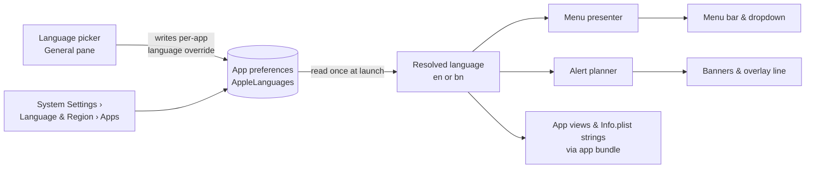

# PRD — Bangla language

**Status:** Approved · **Date:** 2026-11-07 · **Slug:** `bangla-language` · **Owner:** Masnun Siam · **Priority:** medium · **Repo:** masnun-siam/meqat

Status is `Draft`, `In review` or `Approved`. This document is the source of truth for the feature: the tasks and every issue are derived from it, and a decision that is not written here has not been made.

## Overview

Meqat can show all of its text in Bangla (বাংলা) as well as English. The user picks the language in Settings, or lets Meqat follow macOS; after a relaunch the menu bar, dropdown, overlay, notification banners and settings all read in Bangla, with Bangla digits.

Today:
- Meqat is English only; the main PRD lists localization as a non-goal (`meqat.md`, Non-goals).
- Most user-facing text is built in MeqatCore: the menu bar title, dropdown rows, hero, footer and empty states (the menu presenter), and banner and overlay titles (the alert planner). Event names come from one place, the event id's display name.
- Settings, About, the overlay's countdown and buttons, and the dropdown's buttons are written directly in the app's SwiftUI views.
- Every date formatter is pinned to `en_US_POSIX`, a written MeqatCore convention, so times always use Latin digits and English month and weekday names.
- The location-permission prompt text is set in the app's Info.plist build settings.
- The project declares only English (`en`, `Base`) as a known region; there are no string tables.
- The closest pattern is how the time format reaches MeqatCore: the app passes it in as an input, and the presenter and planner build their formatters from it.

## Problem

Many Meqat users in Bangladesh read Bangla more comfortably than English, and the prayer names they know are Bangla spellings (ফজর, যোহর, চাশত). An English-only app with English digits feels foreign for something checked many times a day, and there is no way to change it.

## Users

Every Meqat user, on their own Mac. There are no roles or accounts; the language choice is local to the user.

## Goals

- I can switch Meqat to Bangla from its own Settings, without changing my Mac's language.
- In Bangla, every piece of text Meqat shows me, including notification banners and VoiceOver labels, is Bangla, and times use Bangla digits.
- If my Mac is already set to Bangla, Meqat is in Bangla without me doing anything.
- Upgrading changes nothing for users who don't touch the setting and whose Mac is not in Bangla.

## Non-goals

- Any language other than English and Bangla.
- Switching language without a relaunch.
- Translating calculation-method names (they stay the official institution names, as Aladhan lists them).
- Translating the city or place name: it is shown as the user typed it or as the location lookup returned it.
- Translating the README, docs, release notes, the GitHub release page, the DMG window or the Homebrew cask.
- Bangla digits in version numbers.
- Translating log messages; logs stay English.
- Hijri dates, Bangla calendar dates (বঙ্গাব্দ) or any other calendar.
- Custom AM/PM wording: 12-hour times use the markers macOS's Bangla locale gives.

## Requirements

- **FR-1 Language setting.** The General pane has a Language picker with three options: System, English, বাংলা. Each option is written in its own language ("System" is shown in the current UI language). The default is System. The picker shows the language Meqat is set to, including one set in System Settings › General › Language & Region › Applications.
  - Acceptance: on a fresh install the picker reads System; set Meqat to Bangla in System Settings › Language & Region › Applications, relaunch, and the picker reads বাংলা.

- **FR-2 Relaunch to apply.** Choosing a different language saves it at once and asks the user to relaunch, with Relaunch Now and Later. Relaunch Now quits and reopens Meqat in the new language. Later keeps the current language until the next launch. Choosing the language already in effect asks nothing.
  - Acceptance: choose বাংলা, press Relaunch Now; Meqat reopens with the menu bar title in Bangla. Choose English, press Later; the UI stays Bangla until Meqat is quit and reopened, then it is English.

- **FR-3 System follows macOS.** With System chosen, Meqat is in Bangla when Bangla comes before English in the Mac's preferred languages, and English otherwise (including for any other language).
  - Acceptance: with the Mac's preferred languages Bangla then English and Meqat on System, Meqat launches in Bangla; with French then English it launches in English.

- **FR-4 Everything in-app is translated.** In Bangla, all text Meqat shows is Bangla: the menu bar title and its VoiceOver label; the dropdown (header, hero, rows, forbidden summary, empty states, notifications-off row, update row, footer, buttons); the full-screen overlay (event name, kind line, window, countdown, Dismiss); notification banners, including test alerts; every Settings pane, including About and update messages; error messages; and the location-permission prompt. The only exceptions are listed under Non-goals.
  - Acceptance: in Bangla, walk every Settings pane, open the dropdown in each state the debug harnesses offer, fire a test banner and a test overlay; no English word appears except "Meqat", calculation-method names, the place name and version numbers.

- **FR-5 Event names.** In Bangla, events use this glossary everywhere they appear (menu, overlay, banners, settings):

  | English | বাংলা |
  |---|---|
  | Fajr | ফজর |
  | Dhuhr | যোহর |
  | Jumah | জুমা |
  | Asr | আসর |
  | Maghrib | মাগরিব |
  | Isha | এশা |
  | Tahajjud | তাহাজ্জুদ |
  | Duha | চাশত |
  | Forbidden (sunrise) | নিষিদ্ধ সময় (সূর্যোদয়) |
  | Forbidden (noon) | নিষিদ্ধ সময় (দুপুর) |
  | Forbidden (sunset) | নিষিদ্ধ সময় (সূর্যাস্ত) |

  Units: "min" is মিনিট; the short countdown "1h 5m" is "১ঘ ৫মি" and "12m" is "১২মি". The app name stays "Meqat".
  - Acceptance: in Bangla, with Asr's end alert on at lead 15, the end banner's title contains "আসর" and "১৫ মিনিট" and no Latin letters; the menu row for Duha reads চাশত; a countdown of 65 minutes shows "১ঘ ৫মি".

- **FR-6 Bangla digits and dates.** In Bangla, every number Meqat shows (times, countdowns, leads, offsets, durations, the overlay's closing countdown, dates) uses Bangla digits (০–৯), and weekday and month names in the header and footer are Bangla. Version numbers keep Latin digits. Both 12-hour and 24-hour time formats are honoured.
  - Acceptance: in Bangla with 24-hour format, Fajr at 05:12 shows "০৫:১২"; the header shows the Bangla weekday and month; the About pane shows the version as "1.8.0".

- **FR-7 English unchanged.** In English, every string, number and date is exactly as before this feature.
  - Acceptance: the existing MeqatCore tests for the menu presenter and the alert planner pass unchanged with English as the language.

- **FR-8 Translation review.** The glossary in FR-5 is fixed by this PRD. All other Bangla wording is drafted during implementation and approved by the owner in the pull request that adds it.
  - Acceptance: every pull request that adds Bangla strings lists them for review, and is merged only after the owner approves the wording.

## Edge cases

- **Banners already scheduled.** Banner text is fixed when a banner is scheduled with the system. A relaunch reschedules every pending banner (the scheduler already clears and re-adds them), so after a relaunch all pending banners are in the new language. With Later, banners stay in the old language until the relaunch, matching the rest of the UI.
- **Overlay open during a language change.** The overlay keeps its language until relaunch; Relaunch Now closes it as quitting does today.
- **Reset.** "Reset all settings" and per-pane resets do not change the language; it stays as chosen.
- **Missing translation.** A string with no Bangla entry falls back to its English text rather than showing a key or a blank.
- **Width.** Bangla text and digits are wider in places. The menu bar title, dropdown rows and settings labels must not truncate a prayer name or a time at the default menu bar font size; long labels wrap or the layout grows.
- **Mac set to a third language.** System with, say, Arabic first and no Bangla before English falls back to English (FR-3).
- **Place name in Latin script.** A city typed in English ("Dhaka") is shown as typed, inside otherwise Bangla text.
- **Downgrade.** An older build ignores the language setting and runs in English; the setting stays stored and applies again after upgrading.
- **Existing data.** Nothing migrates. Users upgrading are on System, which keeps them in English unless their Mac prefers Bangla.
- **Data isolation.** The language choice is stored in the user's own preferences; nothing is shared or sent anywhere.

## Technical design

*The language is chosen in one place, resolved once per launch, and passed into MeqatCore like the time format.*

### Data

Serves FR-1, FR-2, FR-3. Store: UserDefaults, the app's own domain, key `AppleLanguages` (the standard macOS per-app language override, the same value System Settings writes). Values: absent for System, `["en"]` for English, `["bn"]` for Bangla. Classification: internal. It is not part of the `settings.*` JSON envelope, so "Reset all settings" leaves it alone and no settings version changes. No migration.

### API

Not affected. The Aladhan and GitHub requests are unchanged; no language parameter is sent.

### Backend

MeqatCore (FR-4 to FR-7):
- **Language as an input.** A language value (English or Bangla) is an explicit input to the menu presenter and the alert planner, next to time zone and time format. They never read the process's preferred language themselves, so Bangla output is testable in `make test` on any machine.
- **Strings.** MeqatCore ships its English and Bangla text as a localized package resource with English as the default localization, and looks strings up in the table for the language it was given. Event display names, countdown units, banner and overlay titles, menu texts and VoiceOver labels all come from it. A missing Bangla entry returns the English text.
- **Formatting.** Display date formatters use the given language's locale (`en_US_POSIX` for English as today, `bn@numbers=beng` for Bangla) with the same fixed date formats, which yields Bangla digits and month and weekday names. Plain `bn` is not enough: macOS formats it with Latin digits. Integers inside strings (leads, countdowns) are formatted with the same locale (`String(format:locale:)`). This replaces the written convention "every DateFormatter uses en_US_POSIX" for display formatters only; formatters that parse or build identifiers (Aladhan dates, alert ids) stay `en_US_POSIX`. The conventions guide is updated in the same change.
- **Language resolution.** A small resolver maps the stored override and the Mac's preferred languages to English or Bangla per FR-3; it is pure and unit-tested.
- Plain English stays byte-identical (FR-7).

### Frontend

The app (FR-1, FR-2, FR-4, FR-6):
- Resolves the language once at launch and passes it to the presenter and planner.
- General pane: Language picker (FR-1). On change it writes `AppleLanguages`, then shows the Relaunch Now / Later prompt (FR-2). Relaunch Now starts a new instance of the app and quits the current one.
- All SwiftUI text, button titles, accessibility labels and the overlay countdown come from the app's own English and Bangla string table. Numbers shown by views use the resolved locale; the version number is formatted without localization.
- The location-permission prompt text has a Bangla translation through the Info.plist string table.
- The project adds `bn` to its known regions.

### Realtime and other components

Not affected. The scheduler already clears and re-adds every pending banner on launch, which is what moves pending banners to the new language.

### Non-functional

- No new dependencies; Apple's own localization only.
- No measurable effect on launch time or memory.
- Text must fit: no truncation of prayer names or times in the menu bar title, dropdown or settings (see Edge cases).
- Logs stay English and never include the user's location, as today.

### Testing

| What | Test |
|---|---|
| FR-3 resolution | Unit: override present/absent × preferred-language lists → en or bn. |
| FR-4, FR-5, FR-6 core text | Unit: menu presenter and alert planner with Bangla input produce the glossary names, Bangla digits, Bangla countdown units, Bangla header and footer dates; for both time formats. |
| FR-7 | The existing English presenter and planner tests run unchanged. |
| Missing translation | Unit: a key with no Bangla entry returns English. |
| FR-1, FR-2, FR-4 app text, width | Manual, recorded in the PR: switch language, relaunch, walk every pane and debug harness (Menu, Overlay, Settings) in Bangla, fire test alerts, check truncation and the location prompt. |
| FR-8 | PR review by the owner. |

## Rollout and cost

Ships to everyone in the next release; users who don't choose Bangla and whose Mac doesn't prefer it see no change. No cost. Release checklist gains a manual step: launch once in Bangla and check the menu, overlay and a test banner. Rollback: release a build without the Bangla table; the stored override is harmless (an unsupported language falls back to English). Watch for issues reporting truncated or wrong Bangla wording.

## Success metrics

None formally defined. There is no telemetry (main PRD non-goal).

## Epics

- **E1 Bangla language** — covers FR-1 to FR-8. Issue: #125

## Decisions

- Base branch `main`, PRD at `docs/prds/bangla-language.md`, single repo — CLAUDE.md names `main` as base and wins over the plugin's `staging` default; the last two PRDs followed this.
- In-app Language picker (System / English / বাংলা) applied on relaunch — a menu bar app's users won't find the System Settings per-app control; relaunch reuses macOS's own override and avoids live-reload plumbing through every view.
- Default is System — a Mac already in Bangla gets Bangla with no setup; everyone else sees no change.
- Bangla digits in Bangla mode — what the `bn` locale formats natively and what Bangla readers expect.
- All in-app text is translated, including banners, settings, About, errors, VoiceOver labels and the location prompt — a half-translated app reads as broken.
- Duha is চাশত — the everyday name in Bangladesh.
- Event-name glossary as in FR-5, units মিনিট and ঘ/মি, app name stays Meqat — common Bangladeshi spellings; reviewed and accepted by the owner.
- Reset does not touch the language — language needs a relaunch, so resetting it mid-session would leave a mismatched UI.
- Agent drafts Bangla text, owner reviews it in each PR — fast to implement while keeping wording under the owner's control.
- Calculation-method names stay in their official form — they are institution names matching Aladhan and mosque usage.
- Language is an explicit input to MeqatCore's presenter and planner — keeps Bangla output unit-testable in `make test`, following the time-format precedent.
- Version numbers keep Latin digits — they must match the GitHub release and Homebrew cask.
- Priority medium — no deadline stated.
- This PRD lifts the main PRD's "localization (English only)" non-goal for Bangla only.
- Bangla display locale is `bn@numbers=beng`, not `bn` — on macOS 14+ plain `bn` formats Latin digits, which fails FR-6 (found while refining the issues).
- 12-hour times in Bangla keep the AM/PM markers macOS's Bangla locale gives (currently Latin "AM"/"PM"), as the Non-goals say; the "no Latin letters" checks in FR-4 and FR-5 apply to the 24-hour format, and AM/PM is an allowed exception in 12-hour format.

## Open questions

None.

## Change log

- 2026-11-07: Bangla locale changed from `bn` to `bn@numbers=beng` (Technical design › Backend › Formatting); AM/PM exception to the "no Latin letters" checks recorded in Decisions. Both from refining the epic #125 issues.

## Related

- `docs/prds/meqat.md` — Non-goals (localization), FR-3, FR-13, FR-15, FR-16 (menu text).
- `docs/prds/alert-styles-per-alert.md` — FR-4 (overlay kind line wording).
- `docs/guides/meqatcore-conventions.md` — the `en_US_POSIX` formatter convention this PRD narrows.
