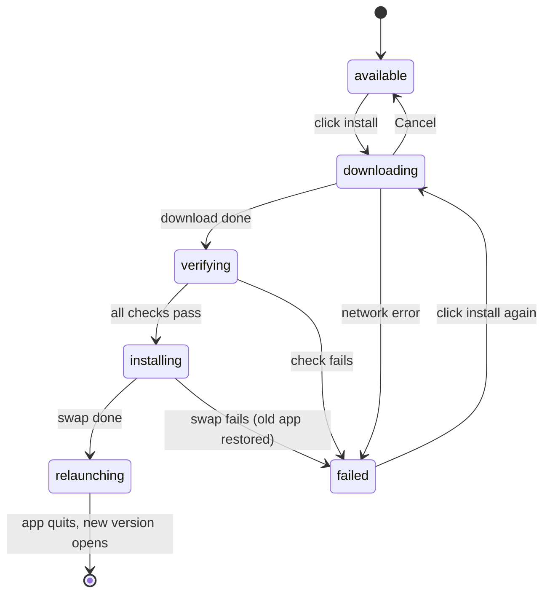
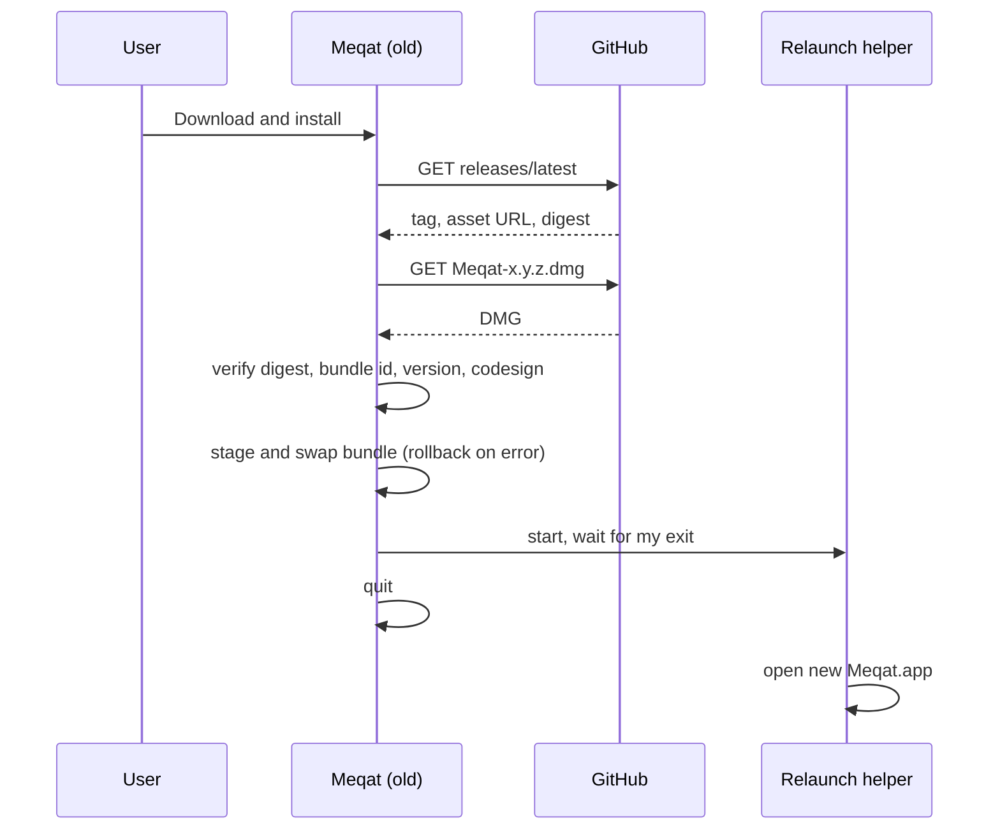

# PRD — In-app update

**Status:** Approved · **Date:** 2026-11-07 · **Slug:** `in-app-update` · **Owner:** Masnun Siam · **Priority:** medium · **Repo:** masnun-siam/meqat

This document is the source of truth for the feature: the tasks and every issue are derived from it, and a decision that is not written here has not been made.

## Overview

When Meqat finds a newer release, the user clicks one button and Meqat downloads that release, checks it, replaces itself and restarts on the new version. The button appears in Settings › About and in the menu dropdown's "Update available" row.

Today:
- The update check (per [about-and-updates.md](about-and-updates.md) FR-2 to FR-6) asks GitHub for the latest release once a day and on "Check now". When a newer version exists, About shows "Version x.y.z is available", a "View release" link and the `brew upgrade --cask meqat` hint. The dropdown shows "Update available — x.y.z", which opens the release page.
- Each GitHub release has one asset, `Meqat-<version>.dmg`, holding `Meqat.app`. GitHub publishes the asset's SHA-256 as `digest`.
- Release builds are ad-hoc signed, not notarized, and carry no entitlements, so the released app is not sandboxed and may write outside its container. Debug builds keep the sandbox.
- Nothing downloads or installs a release. Both earlier PRDs list this as a non-goal; this PRD withdraws those non-goals (see their change logs).

## Problem

Updating takes several manual steps: open the release page, download the DMG, mount it, drag the app to Applications, replace the old copy, eject, relaunch. Most users put this off and keep running builds with known bugs.

## Users

Every Meqat user, on their own Mac. There are no roles or accounts.

## Goals

- When an update is available, one click gets me the new version running.
- A failed or cancelled update leaves my current Meqat running and untouched.
- Meqat never installs anything I did not click for.

## Non-goals

- Downloading or installing without a click: no background pre-download and no silent auto-install.
- Asking for an administrator password, or installing into a folder the user cannot write to.
- "Restart later" or install-on-quit. The restart happens right after the install.
- Delta or patch updates. The full DMG is downloaded every time.
- Downgrades and pre-release channels. Only GitHub's "latest" release counts, per about-and-updates FR-4.
- Keeping Homebrew's records in sync. Homebrew users get the same in-place install.
- Developer ID signing or notarization. There is still no Apple Developer account.
- Release notes inside the app.

## Requirements

- **FR-1 Install button.** While the update status is "available" and installing is possible (FR-7), About shows a "Download and install" button under "Version x.y.z is available". The "View release" link and the Homebrew hint stay below it. Clicking the dropdown's "Update available — x.y.z" row starts the same install instead of opening the release page, and closes the dropdown.
  - Acceptance: with 1.7.0 installed in `/Applications` and GitHub's latest at `v1.8.0`, About shows "Download and install". Clicking it, or the dropdown row, starts the download, and no browser window opens.

- **FR-2 Download with progress.** The install downloads the release's `Meqat-<version>.dmg` asset. About shows "Downloading… <n>%" with a "Cancel" button. The dropdown row reads "Downloading update… <n>%" and cannot be clicked. Cancel stops the download, deletes the partial file and returns to "Version x.y.z is available".
  - Acceptance: clicking install shows a percentage that rises to 100. Clicking Cancel at any point before 100% returns About to the available state, and no file from the update is left in the app's temporary folder.

- **FR-3 Verify.** Before anything is replaced, the downloaded update must pass every check below. Any failure aborts the update (FR-6).
  - The DMG's SHA-256 equals the asset's `digest` from GitHub. A missing `digest` counts as a failure.
  - The DMG holds `Meqat.app` with bundle identifier `com.masnunsiam.Meqat`, and its `CFBundleShortVersionString` equals the release's version.
  - `codesign --verify --deep --strict` passes on that app.
  - Acceptance: a fake release whose digest does not match, whose app has another bundle id, whose version differs from the tag, or whose signature is broken ends in "Update failed", and the installed app is unchanged.

- **FR-4 Replace.** After verification, About and the dropdown show "Installing…". The new `Meqat.app` replaces the running app at the same path, keeping its name and location. If the replacement fails at any point, the original app is restored and keeps running.
  - Acceptance: after a successful install, `/Applications/Meqat.app` reports version 1.8.0, and there is exactly one `Meqat.app` in `/Applications`. If a write fails partway (simulated in tests), the original 1.7.0 bundle is back at its path, byte for byte.

- **FR-5 Restart.** Right after the replacement, Meqat quits and the new version launches on its own, with no prompt. An overlay on screen does not delay this. Settings, cache and location carry over, because they live outside the app bundle.
  - Acceptance: after clicking install, within 10 s of the download finishing, the menu bar item is back and About shows "Version 1.8.0 (n)". Settings and the prayer schedule match those from before the update.

- **FR-6 Failure.** A failed download (offline, timeout, non-200), a failed verification or a failed replacement shows "Update failed" with the "View release" link in About, logs the failure kind (no URL or path), deletes the temporary files and leaves the running app as it was. The dropdown row returns to "Update available — x.y.z", so the user can retry. Prayer-time sync and alerts are never affected.
  - Acceptance: with Wi-Fi off, clicking install shows "Update failed" with "View release". The app keeps running 1.7.0, and clicking the row again retries.

- **FR-7 When install is not possible.** Install is offered only when the running app's bundle is in a folder the user can write to, is not on a read-only volume (such as the mounted DMG) and is not translocated, and the app is not sandboxed (debug builds are). Otherwise About and the dropdown behave exactly as before this feature: no button, and the row opens the release page.
  - Acceptance: running Meqat straight from the mounted DMG, or a debug build, shows no "Download and install" button, and the dropdown row opens the release page.

## Edge cases

- **Concurrency.** Only one install runs at a time. While one runs, the button and the dropdown row are disabled, and an update check started then (scheduled or "Check now") is skipped. If a check during an earlier failure reports an even newer version, the next install uses that newer one.
- **Release changed under us.** The install uses the version, asset URL and digest from one fresh `releases/latest` response taken when the user clicks, not from an earlier check. If that response has no `Meqat-<version>.dmg` asset, the update fails with FR-6.
- **Quitting during install.** Quitting Meqat during the download cancels it. Quitting during replacement waits for it to finish or roll back, so the bundle is never left half-written.
- **Toggle off.** With automatic checks off, "Check now" can still find an update, and About still shows the button. The dropdown row stays hidden, as in about-and-updates FR-5.
- **Homebrew installs.** These are replaced in place like any other. Brew keeps its old version record, so a later `brew upgrade` reinstalls the same or a newer version, which does no harm.
- **Permissions after update.** Each ad-hoc build has a new signature, so macOS may ask again for location access or the login item. This already happens after a manual upgrade, and the release checklist covers it.
- **Quarantine.** The app downloads the DMG itself and does not tag it with the quarantine attribute, so the new app launches without the first-launch "unidentified developer" block. A test checks that the installed bundle has no `com.apple.quarantine` attribute.
- **Disk space.** If there is not enough space to download or stage the update, the update fails with FR-6.
- **Empty state.** No update available means no button, as today.
- **Data isolation.** Single-user local app. The only data that leaves the Mac is the anonymous GitHub API request and the asset download, neither of which sends any user data.
- **Existing data.** None to migrate. No new settings.

## Technical design

### Data

No persisted data. The install state lives in memory only. Temporary files (the DMG and the staged app) go in the app's temporary folder or in a staging folder on the same volume as the installed app, and are deleted when the install succeeds, fails or is cancelled.

### API (FR-1, FR-3)

Same endpoint and headers as about-and-updates (`GET https://api.github.com/repos/masnun-siam/meqat/releases/latest`, `Accept: application/vnd.github+json`, `User-Agent: Meqat`, no query string). The release client also reads `assets[]`, and for the entry whose `name` is `Meqat-<version>.dmg` it takes:

- `browser_download_url`: an `https` URL on `github.com`; the download follows GitHub's redirect.
- `digest`: a string `sha256:<64 hex>`.

The download is a plain `GET` with `User-Agent: Meqat` and no other identifying header. It has a 60 s inactivity timeout, no retries, and a size cap of 50 MB (today's DMG is about 1.7 MB). A response over the cap fails.

The update check (about-and-updates FR-2) reads these fields too, but ignores them, so a release without the asset is still reported as available. Installing it then falls back per FR-6.

### Backend (MeqatCore)

- **Installer** (FR-2 to FR-6): owns the install state machine below. It downloads through an injectable transport, then verifies, stages and replaces. It is in MeqatCore and tested against temporary folders, with fakes for the download, the DMG mount, the signature check and the relaunch.
- **Install-eligibility check** (FR-7): a pure decision from the bundle's path, volume, translocation and sandbox state, so each case is unit-tested.
- **Replacement** (FR-4): the verified app is copied into a staging location on the same volume, then swapped into place atomically, with the old bundle kept until the swap succeeds. On any error the old bundle is put back.
- **DMG handling**: mounted read-only and hidden from Finder, the app copied out with its metadata kept, then detached, even on failure.
- **Relaunch** (FR-5): the app starts a small detached helper that waits for this process to exit and then opens the new bundle. The app then quits normally.
- **Update status**: `available` gains whether install is possible, and the menu presenter derives the row's title and action (install, progress, or open the release page) from the install state, so the row is decided and tested in MeqatCore like the other rows.

*Install lifecycle. `failed` shows "Update failed" plus "View release".*

*One successful install.*

### Frontend (app)

- **About pane** (FR-1, FR-2, FR-4, FR-6): in the available state, a "Download and install" button sits above "View release" and the Homebrew hint. While downloading, it shows "Downloading… n%" and "Cancel"; while verifying or installing, "Installing…"; after a failure, "Update failed" and "View release". When install is not possible (FR-7), the pane looks as it does today.
- **Dropdown row** (FR-1, FR-2): "Update available — x.y.z" starts the install and closes the dropdown. During the install it reads "Downloading update… n%" or "Installing update…" and is disabled. When install is not possible, it opens the release page as today.
- The app wires the installer to the existing update checker, the About pane and the status item. On quit it cancels a download and waits for a running swap to finish.

### Realtime and other components

Not affected. Release tooling is unchanged: the installer relies on the existing asset name `Meqat-<version>.dmg`, the `v<x.y.z>` tag, the app at the DMG root, and releases built with no entitlements. The release checklist gains a line saying these must stay that way.

### Non-functional

- Security: the update is accepted only if it matches GitHub's published digest, the bundle id and the expected version. Ad-hoc signing cannot prove who built it, so the trust root is the GitHub repository, the same as a manual download today. Downloads use `https` only. Logs hold the failure kind only.
- Privacy: no user data is sent. The no-telemetry rule holds.
- Network: only on click; about 2 MB per update.
- No third-party dependency (no Sparkle). It uses only system tools that ship with macOS (`hdiutil`, `codesign`, `ditto`, `open`).
- Debug builds keep the sandbox and so never offer install (FR-7). Testing the full flow needs a `scripts/release.sh` build.

### Testing

- **Unit (MeqatCore, fakes)**: asset parsing (present, missing, bad digest format); digest match and mismatch (FR-3); bundle id and version checks (FR-3); eligibility for writable, read-only, translocated and sandboxed (FR-7); a swap that succeeds, and one that fails at each step with the original bundle restored byte for byte (FR-4); cancel removes the partial files (FR-2); state transitions, including retry after failure and a check skipped during install (Edge cases); menu row title and action in each state.
- **Live (`make test-live`)**: the real latest release has a `Meqat-<version>.dmg` asset with an `https` URL and a `sha256:` digest.
- **Manual (release checklist)**: from the previous release in `/Applications`, click install in About and in the dropdown, and each time Meqat relaunches on the new version with settings intact (FR-1, FR-5). Cancel mid-download (FR-2). With Wi-Fi off, the install fails cleanly (FR-6). From the mounted DMG, no button shows (FR-7). After the update, `xattr` shows no quarantine on the installed app.

## Rollout and cost

Everyone at once in the next release. No cost. Users on 1.7.0 or earlier must update by hand one last time, since only versions that have this feature can install themselves. Rollback: publish a newer patch release, because downgrades are not offered. After release, watch GitHub issues for failed-update reports.

## Success metrics

None formally defined. Meqat has no telemetry.

## Epics

- **E1 In-app update** — covers FR-1 to FR-7. Issue: #136

## Decisions

- The install button is in About, and the dropdown's "Update available" row also starts the install. — One click wherever the user notices the update, reusing both existing places.
- Homebrew installs are replaced in place like any other. — No detection code; brew's stale record does no harm, since a later `brew upgrade` just reinstalls.
- Restart right after the install, with no prompt. — The click is consent; a "later" path would add install-on-quit to build and test.
- A new PRD, with change-log lines in `meqat.md` and `about-and-updates.md` withdrawing their "no auto-updater" non-goals. — Epic #78 is closed, and this is a separate, releasable feature.
- Verify by GitHub's SHA-256 digest, plus bundle id, version and `codesign --verify`. — Catches corruption and a mispackaged DMG. Ad-hoc signing gives no stronger identity, so this matches a manual download.
- When the app can't replace itself, fall back to today's release link. — No admin prompt, no privileged helper, nothing half-done.
- Show a download percentage with Cancel, then "Installing…". A failure keeps the old app and shows "Update failed" with "View release". — A slow download should not look frozen, and every failure is recoverable.
- Proceed even if an alert overlay is on screen. — The user is at the Mac, and alerts are re-planned at launch.
- Download only on click, never in the background. — No traffic or disk use without consent, in line with the no-telemetry stance.
- The install takes the version, asset and digest from a fresh `releases/latest` call at click time. — Avoids installing a release that changed after the last check.
- Built in-house with macOS system tools, not Sparkle. — Project rule: no third-party packages.
- Priority medium. — It saves DMG users several steps; nothing is broken today.
- One epic. — It ships as one release.

## Open questions

None.

## Change log

## Related

- [about-and-updates.md](about-and-updates.md): update check, status and menu row this builds on.
- [meqat.md](meqat.md): distribution and non-goals.
- `docs/release-checklist.md`, `scripts/release.sh`: asset name and build settings this relies on.
