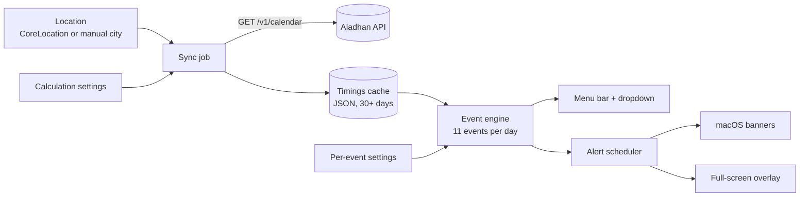
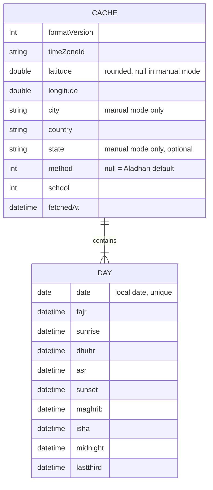
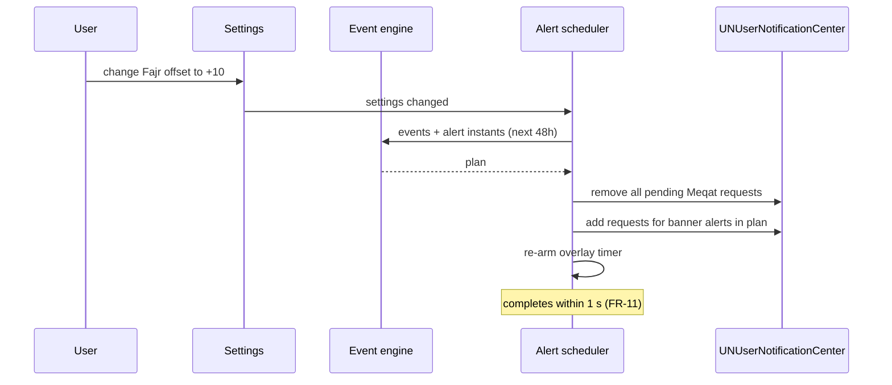

# PRD — Meqat

**Status:** Approved · **Date:** 2026-10-28 · **Slug:** `meqat` · **Owner:** Masnun Siam · **Priority:** medium · **Repo:** masnun-siam/meqat

Status is `Draft`, `In review` or `Approved`. This document is the source of truth for the feature: every issue is derived from it, and a decision that is not written here has not been made.

## Overview

Meqat (*Miqat*, "appointed times") is a macOS 14+ menu bar app that tracks 11 Islamic time events: the five daily prayers, Jumah, Duha, Tahajjud, and the three prohibited windows (*Awqat al-Nahy*). Each event alerts the way the user has set it up: a full-screen overlay, a system banner, or nothing. Times come from the Aladhan API for the user's location and are cached 30+ days ahead, so the app keeps working offline.

Today:
- The repository is empty apart from the README. There is no code, no Xcode project and no docs.
- No existing feature to follow. Platform conventions (System Settings layout, `UserNotifications`, `SMAppService`) set the pattern.
- Everything in this document is new.


*Data flows from location and settings, through sync and the cache, to the engine, then to the menu bar and alerts.*

## Problem

Prayer times are easy to find, but a desktop tool that fits how a person actually prays is harder: one alert style for every prayer is easy to miss or too intrusive, and the prohibited windows, Duha, Jumah and Tahajjud get little attention. That risks praying in a prohibited window by accident, missing voluntary prayers, and losing alerts when offline or travelling.

## Users

A single local user on their own Mac: Muslim engineers, remote workers and desktop power users. There are no accounts, no roles and no server. All data lives on that Mac.

## Goals

- From the first launch, without configuration, I see the next event and a countdown in the menu bar.
- I choose how hard each event interrupts me: overlay, banner or silent. Out of the box every alerting event is a Banner; differentiating events is opt-in.
- I can line alerts up with my mosque (start offsets, static times) and get wrap-up alerts before an event ends.
- I always know when I'm inside a prohibited window.
- Alerts stay correct offline for 30 days, and when I travel or the clock changes for DST.

## Non-goals

- Mosque iCal/RSS feeds, iCloud sync, and iOS/iPadOS apps or widgets.
- The makruh periods after Fajr until sunrise and after Asr until sunset. Only the three windows in FR-3 exist.
- Calculating times on the device. Aladhan is the only source; there is no local astronomy fallback.
- Adhan audio or custom sounds. Banners use the system default sound.
- Hijri date display, Qibla direction, and localization (English only).
- Late alerts for events that came and went while the Mac was asleep (FR-12).
- An in-app auto-updater (for example Sparkle). Updates come through Homebrew or a manual download.
- Snooze on the overlay.
- Mac App Store distribution in v1. The sandbox stays on so it remains possible later.
- Telemetry or analytics of any kind.

## Requirements

### Events and times

- **FR-1 Event set.** The app tracks 11 events per day:

  | Event | Kind | Start | End |
  |---|---|---|---|
  | Tahajjud | voluntary | previous date's Aladhan `Lastthird` | Fajr |
  | Fajr | obligatory | `Fajr` | `Sunrise` |
  | Shuruq | prohibited | `Sunrise` | Sunrise + Shuruq duration |
  | Duha | voluntary | end of Shuruq | start of Istiwa |
  | Istiwa | prohibited | Dhuhr − Istiwa duration | `Dhuhr` |
  | Dhuhr | obligatory (not Fridays) | `Dhuhr` | `Asr` |
  | Jumah | obligatory (Fridays only) | `Dhuhr`, or its Static time | `Asr` |
  | Asr | obligatory | `Asr` | `Sunset` |
  | Ghurub | prohibited | Sunset − Ghurub duration | `Sunset` |
  | Maghrib | obligatory | `Maghrib` | `Isha` |
  | Isha | obligatory | `Isha` | Aladhan `Midnight` (Islamic midnight) |

  Each day shows 10 events: Dhuhr on Saturday to Thursday, Jumah on Friday. Prohibited-window durations default to Shuruq 15, Istiwa 10 and Ghurub 15 minutes, each adjustable from 5 to 30 minutes in General settings.
  - Acceptance: given a fixture of Aladhan timings for a Friday and default settings, the engine returns exactly 10 events with the starts and ends in the table: Jumah at Dhuhr's time, no Dhuhr, Istiwa = Dhuhr − 10 min → Dhuhr, Duha = Sunrise + 15 → Dhuhr − 10. The same fixture labelled as a Thursday returns Dhuhr and no Jumah.

- **FR-2 Night events across midnight.** Tahajjud and Isha's end can fall after 00:00. Aladhan attaches each night's `Lastthird` to the date the night begins, so it falls on the next calendar date (checked against the live API: 28 Oct gives `2026-10-29T01:49+06:00`). A day's list therefore takes Tahajjud from the previous date's `Lastthird`, so it comes before that day's Fajr. Isha's end is that night's `Midnight`, even when it falls on the next calendar date. All times are absolute instants, so no start/end difference is ever negative.
  - Acceptance: with a fixture where Midnight is 00:14 on the next date, Isha's end is that next-date instant, and the end-alert time for a 15-minute lead is 23:59 on the Isha date. With fixtures where 27 Oct's `Lastthird` is 28 Oct 02:50, the list for 28 Oct starts Tahajjud at 02:50 on 28 Oct and ends it at 28 Oct's Fajr.

- **FR-3 Prohibited windows in the menu.** While the current time is inside Shuruq, Istiwa or Ghurub, the menu bar shows a warning state with the window's name and the time until it ends (FR-15).
  - Acceptance: with the clock set inside Istiwa, the status item reads `⛔ Istiwa ends in Nm`. One minute after the window ends, it returns to the next-event countdown.

### Location and sync

- **FR-4 Location.** On first launch the app asks for location permission. If granted, it uses the device location and refreshes it at most every 2 hours (significant changes only). If permission is denied or the location fails, the Location pane offers a manual City and Country, and the app uses Aladhan's city calendar instead. The user can also switch to manual mode at any time. Coordinates are rounded to 2 decimal places (~1 km) before they leave the Mac. City, country and an optional state or region (sent as Aladhan's `state` to tell apart cities with the same name) are committed on Return or a "Look up" button (never per keystroke), trimmed, limited to 100 characters and percent-encoded as query values; the commit control is disabled while City or Country is empty. While the first attempt runs the pane shows "Looking up…" and the commit control is disabled; it then shows the entered city, country and state (if any), "City not found", or, after any other failed attempt, "Couldn't reach the server — try again" with the control re-enabled (retries continue in the background, FR-8). Manual mode gets no coordinates from Aladhan. Only the current location is stored: switching mode clears the other mode's stored values. Coordinates, city and request URLs are never written to the system log in readable form. While the location prompt is unanswered, location stays pending with no timeout. If permission is granted but no fix arrives within 10 s, location counts as failed (FR-16).
  - Acceptance: with permission denied and no manual city, the menu shows the "Set your location" empty state (FR-16). Entering `Dhaka`/`Bangladesh` and pressing Return loads a schedule. The request URL recorded by the stubbed HTTP layer carries coordinates with at most 2 decimals, and a city value of `X&method=99` is sent percent-encoded as one parameter. A state value is sent as one encoded `state` parameter, and changing only the state triggers a fetch. Switching from automatic to manual mode clears the stored coordinates, and the reverse clears the city. Granted permission with no fix for 10 s shows "Set your location"; an unanswered prompt keeps showing "Waiting for location permission…". With the city lookup returning 503, the pane shows "Couldn't reach the server — try again" and Look up is enabled.

- **FR-5 Calculation settings.** General settings let the user pick the calculation method (Aladhan's method list) and the Asr school (Shafi'i, the default, or Hanafi). By default no method is sent, so Aladhan picks the nearest authority (see Decisions for the fallback).
  - Acceptance: changing the school to Hanafi triggers a fetch, and the new Asr time is later than the Shafi'i time for the same day.

- **FR-6 Fetch and cache.** The app keeps a cache covering yesterday through today + 30 days, filled from Aladhan's monthly calendar: the current month, then as many following months as it takes to reach today + 30 (the next month, plus the one after when needed, for example on 30 and 31 January). The cache survives restarts. Data in it is only valid for the location, method, school and system time zone it was fetched with.
  - Acceptance: after one successful sync, with the network turned off and the app restarted, the menu shows today's schedule, and the cache file holds every date from yesterday to today + 30. This also holds with the clock on 30 Jan, where the sync fetches three months.

- **FR-7 Sync policy.** A background job runs every 2 hours and fetches only when at least one of these holds: the cache does not reach today + 30 days; the location moved more than 5 km from the cached location, or the manual city, country or state changed; the method or school changed; the system time zone changed. Otherwise it makes no request. The 2-hour interval is approximate. Changing location, method or school in Settings (changes within 1 s are merged into one trigger), a time zone change, and the dropdown's "Refresh now" each start a sync immediately. Only one sync runs at a time. A trigger with the same parameters as the running sync joins it; a trigger whose parameters differ (for example a newer method) queues exactly one follow-up sync with the newest settings. "Refresh now" is disabled while a request is in flight and enabled during a backoff wait (the footer shows "Offline" then). HTTP 429 counts as a failure (FR-8).
  - Acceptance: with a fresh cache and nothing changed, the 2-hour job makes zero requests. Changing the system time zone produces exactly one sync within 5 seconds. Three "Refresh now" presses while one sync is held in flight (stubbed HTTP held for 2 s) produce one sync: 2 requests (3 when three months are needed). Picking method B and then C during a sync for B produces the B sync plus one follow-up for C, and the cache ends on C.

- **FR-8 Network failure.** Each request times out after 5 seconds. On failure the app logs a warning (without location data), keeps using the cache, and retries after waits of 15 s, 30 s, 1 min and 5 min, each measured from the end of the previous failed attempt, then goes back to the 2-hour cycle. Retries use exact in-app timers. A "Refresh now", settings change or time zone change during the wait cancels it and starts a fresh sync at once, restarting the sequence. A failed fetch never deletes or changes cached data. The footer shows "Offline — using cache from <date>" from the first failed sync until the next successful one; a failed manual refresh also shows "Couldn't refresh" for 5 s (checked in the manual checklist).
  - Acceptance: with the API blocked (connection refused), the log shows five attempts, with waits of 15 s, 30 s, 1 min and 5 min between a failure and the next attempt, then nothing until the next 2-hour run. The schedule is unchanged throughout.

### Alerts

- **FR-9 Per-event alert style.** Each event has one style: Full-Screen Focus, Banner, or Disabled. Defaults: Banner for Fajr, Dhuhr, Jumah, Asr, Maghrib, Isha, Shuruq, Istiwa and Ghurub; Disabled for Duha and Tahajjud. A Disabled event still appears in the dropdown and never raises a banner or overlay, including its pre-warning.
  - Acceptance: setting Asr to Disabled removes all of Asr's pending notifications, and no Asr alert appears at Asr time, but Asr is still listed in the dropdown.

- **FR-10 Per-event timing.** Each event has:
  - **Time source:** Calculated (from FR-1) or Static `HH:mm`, chosen with a time picker, in the system time zone and on the event's own list date (a time that doesn't exist on a DST day moves to the next valid minute). The exception is Tahajjud: a Static time at or after the previous calendar date's Isha start (clock time) falls on that previous date (the night before), and an earlier time falls on the list date. Static replaces the event's start for every day. For the prohibited windows, Static sets the window start and the window keeps its duration, so the end moves with it. For every other event, Static does not change the event's end. Duha always uses the effective bounds: it starts at the end of Shuruq and ends at the start of Istiwa, Static or calculated.
  - **Start alert:** on/off (default on), with an offset from −60 to +60 minutes (default 0). It fires at start + offset.
  - **End alert:** on/off (default off), with a lead time from 1 to 120 minutes (default 15). It fires at end − lead.
  - **Pre-warning:** on/off (default off), with a lead time from 1 to 120 minutes (default 20). It fires at start − lead and is always a Banner, even for Full-Screen events.
  - **Overlay minimum hold:** 0 to 300 seconds (default 60). Used only when the style is Full-Screen.

  Values outside these ranges cannot be entered: steppers and pickers stop at the bounds, and a typed out-of-range value is clamped to the nearest bound. An alert whose computed time is already past when it is scheduled is skipped.
  - Acceptance: with Dhuhr at 11:46, Start offset +5, End alert on with lead 15, and Asr at 15:04, Dhuhr alerts fire at 11:51 and 14:49. Setting Static 12:30 moves the start alert to 12:35, and the end alert stays at 14:49. With Istiwa Static 11:30 and the default 10-minute duration, Istiwa runs 11:30–11:40 and Duha ends at 11:30. A Static Tahajjud of 04:00 with Fajr at 04:52 runs 04:00–04:52; with the previous date's Isha at 18:42, one of 23:30 falls on the previous date and runs 23:30–04:52. One exactly at the previous date's Isha clock time also falls on the previous date; one of 12:00 falls on the list date after Fajr, so it shows as "—" and gets no alerts.

- **FR-11 Instant rescheduling.** Any settings change or new sync replaces every pending alert within 1 second. No stale alert from the old settings fires.
  Several changes in quick succession merge into one rebuild that uses the newest settings.
  - Acceptance (default settings, so the 60-alert cap in Limits drops nothing): change Fajr's offset from 0 to +10 and list the pending notification requests. Within 1 s there is exactly one Fajr start request per Fajr occurrence in the next 48 hours, each at its new time, and none at the old time. Ten stepper changes within 1 s leave the pending set equal to the plan for the last value.

- **FR-12 Missed alerts.** An alert more than 5 s past its instant when the app gets to fire it is dropped; nothing fires late. To make this true for banners already handed to macOS, the app removes all its pending notification requests when the Mac goes to sleep and when the app quits, and rebuilds the plan on wake and at launch. A crash, force-quit or sudden sleep (low battery, forced sleep) can leave requests behind, and macOS may deliver those late on wake; this is a known v1 limit. Only the alert timer is exempt from throttling while the app is in the background: idle system and display sleep are unaffected and idle Energy Impact averages below 1 in Activity Monitor over 10 idle minutes. So the 5 s tolerance and FR-13's 1 s budget hold there too. As a result, Fajr and Tahajjud alerts only fire if the Mac is awake and Meqat is running at that time.
  - Acceptance: sleep the Mac across Asr's start alert and wake it 10 minutes later. No Asr banner or overlay appears, and the next event's alert still fires on time. Quit Meqat before Asr and no Asr banner appears. With the app idle in the background for 30 minutes, an alert still fires within 1 s of its time.

- **FR-13 Banner alerts.** A Banner alert is a macOS notification titled with the event name and showing its time (for example "Asr · 15:04", "Dhuhr ends in 15 min", "Fajr in 20 min"). A prohibited-window banner says so: "⛔ Istiwa · avoid praying until 11:46" at its start, "Istiwa ends in 15 min" at its end alert, "⛔ Istiwa in 20 min" as a pre-warning. Banners are scheduled for their computed time and fire within 1 second of it while the Mac is awake; macOS may hold them back under a Focus mode. Clicking a banner only dismisses it. If notification permission is denied, the dropdown shows a "Notifications are off — Open System Settings" row and Full-Screen alerts still work. While permission is denied, a Banner alert that fires also shows `● <event> now` in the status item until the dropdown is opened or 5 minutes pass.
  - Acceptance: with permission granted, a Banner event produces one notification at its time. With permission revoked, the warning row appears, and a Banner event at its time shows `● <event> now` in the status item.

- **FR-14 Full-Screen Focus overlay.** A Full-Screen alert covers every connected display, above full-screen apps and every Space, with a gradient background, the event name, its time and its end time. It blocks clicks and typing to the apps underneath while Meqat is the active app. System shortcuts (Cmd-Tab, Mission Control, Force Quit) still work; after the user switches to another app, keystrokes go to that app (a known limit), and clicking the overlay returns key focus to it and to Dismiss. A Dismiss button is disabled and shows a countdown until the event's minimum hold has passed, then becomes the default button; Return or Esc then closes the overlay, and Esc does nothing before then. The hold counts only time the overlay is visible. Dismiss has keyboard focus on the primary display's panel. If another Full-Screen alert fires while one is showing, the new one replaces its content and its own hold starts. The overlay never closes by itself. It is never shown above, and never takes input from, the lock screen, login window or screensaver: while the session is locked it stays hidden and appears after unlock with its remaining hold, unless its event has ended by then, in which case it is dropped and never shown. It announces the event name and the hold countdown to VoiceOver, its text meets WCAG AA contrast on every gradient, and it uses no animation under Reduce Motion.
  - Acceptance: with a hold of 60 s, Dismiss is disabled for 60 s and then closes the overlay on every display; Return and Esc also close it after the hold. With a hold of 0, Dismiss is active at once. With Xcode in a full-screen Space, the overlay appears above it. A second Full-Screen alert while one shows replaces its content and restarts the hold. An alert firing while the screen is locked shows no overlay over the lock screen. Locking the screen across the event's end and unlocking after it shows no overlay.
### Menu bar and settings

- **FR-15 Menu bar status.** The status item shows a crescent icon and `<next event> in <countdown>` (for example `☾ Asr in 1h 12m`, or `☾ Asr in 12m` under an hour). The next event is the earliest event whose start is after now and whose style is not Disabled; Disabled events never count, but prohibited windows do unless Disabled. The search runs across dates, so after the last event of a day it is the next day's first eligible event. The countdown is rounded down to whole minutes, shown as `Nh Mm` (`1h 0m` on the hour) and `<1m` under a minute. It updates every minute on the minute. Inside a prohibited window it shows the FR-3 warning state instead, even when that window's style is Disabled (Disabled only silences alerts). When no event qualifies as next, it shows the crescent alone. The status item and each row have VoiceOver labels, for example "Asr, next, in 1 hour 12 minutes" and "Istiwa, prohibited window, 11:36 to 11:46".

  The dropdown shows the date and place, then a hero for the status item's event: inside a prohibited window (even when Disabled) its name, "N left", progress through the window, its start and the next event with its time, tinted red; otherwise the current event the same way; otherwise "Next · <event>" with the countdown and its start, without progress. With neither, the hero is omitted. Below it are the 7 prayers and Duha of the calendar date in time order, rolling over at 00:00 local time (so Isha still running after midnight appears in the previous date's list, and Tahajjud is listed under the date of the Fajr it ends at, even if `Lastthird` falls before 00:00; a Static Tahajjud that starts the night before shows as current (●) in today's list from its start, and its start is labelled "(prev. night)" in the next day's list). A row is done once its end has passed (✓), current while now is between its start and end (●), and next when it is the status item's next event (○); rows carry no countdown. Duha is shown as `start–end`. A line under the list reads "Next forbidden <start>–<end>" for the next prohibited window of the date still to start, whatever its style, or "No more forbidden windows today". The footer is one line: "Synced HH:mm" (or "Synced <date> HH:mm" when not today), "Syncing…" while a sync runs, or "Offline — using cache from <date>" (FR-8), then Refresh (↻) and Settings (⚙) icon buttons with tooltips and VoiceOver labels, and "Quit".
  - Acceptance: at 13:52:30 with Dhuhr 11:46 and Asr at 15:04, the item reads `☾ Asr in 1h 11m`. The dropdown's hero reads Dhuhr, `1h 11m left`, `11:46`, `Asr 15:04`; it lists 7 rows: Tahajjud, Fajr and Duha done, Dhuhr current, Asr next; and the line reads `Next forbidden 17:12–17:27`. With the mockup's times and defaults (Duha Disabled) at 06:20, the item reads `☾ Istiwa in 5h 16m` and Duha still has a row. With every event Disabled outside a prohibited window it shows the crescent alone, and inside Istiwa set to Disabled it still reads `⛔ Istiwa ends in Nm`.

```
Menu bar:  ☾ Asr in 1h 11m

╭────────────────────────────────────────╮
│ Wed 28 Oct · Dhaka                     │
│                                        │
│ DHUHR                                  │
│ 1h 11m left                            │
│ ████████████████████████░░░░░░░░░░░░░  │
│ 11:46                        Asr 15:04 │
├────────────────────────────────────────┤
│ ✓ Tahajjud                       01:00 │
│ ✓ Fajr                           04:52 │
│ ✓ Duha                     06:20–11:36 │
│ ● Dhuhr                          11:46 │
│ ○ Asr                            15:04 │
│   Maghrib                        17:27 │
│   Isha                           18:42 │
├────────────────────────────────────────┤
│ ⊘ Next forbidden 17:12–17:27           │
├────────────────────────────────────────┤
│ Synced 13:50                 ↻  ⚙  Quit│
╰────────────────────────────────────────╯
```
*The status item and dropdown, as chosen in the interview.*

- **FR-16 Empty and error states.** When the cache has an entry for today, the dropdown shows the event list, never an empty state (a revoked permission only adds a warning row). Otherwise it shows exactly one of these, in this order of precedence: "Waiting for location permission…" (automatic mode only, prompt unanswered; entering a manual city switches to manual mode and ends it; with a button to the Location pane so the user can enter a city instead); "Fetching times…" (a request is in flight, or location is granted with no fix yet; a backoff wait does not count, so the dropdown doesn't flip on each retry); "Set your location" (no location and no manual city, with a button to the Location pane); "City not found — check Location settings" (the last sync got Aladhan's 400, with a button to the Location pane); "No schedule — connect to the internet" (any other failed sync, with a "Try again" button). The status item then shows the crescent alone.
  - Acceptance: on a clean install with a manual city set and the network off, the dropdown shows "No schedule — connect to the internet" and no alerts are scheduled. With permission denied and no manual city it shows "Set your location". With a valid cache from yesterday that no longer covers today and a request in flight, it shows "Fetching times…"; during a backoff wait it shows "No schedule — connect to the internet". With the prompt unanswered it shows "Waiting for location permission…", and entering a city then leads to "Fetching times…" and then the list.

- **FR-17 Settings window.** A sidebar and detail window, like System Settings. The sidebar has **General** (launch at login, method, school, time format, the three prohibited-window durations), **Location** (automatic or manual city, country and optional state, current place, last sync), then the 11 events in day order. Selecting an event shows all of its FR-9 and FR-10 controls and a "Reset to defaults" button for that event. General has "Reset all settings" (after a confirmation), which restores every default but keeps the location. Changes apply immediately; there is no Save button (except the city lookup in FR-4). "Settings…" and the "Set your location" button activate the app and bring the single Settings window to the front, on the chosen pane.
  - Acceptance: every control in FR-9 and FR-10 can be reached for each of the 11 events, and quitting and relaunching keeps every value. "Reset to defaults" on Dhuhr restores its FR-9 and FR-10 defaults and leaves other events alone; "Reset all settings" restores all of them and keeps the location.

```
┌─────────────┬──────────────────────────────────────┐
│ General     │ Dhuhr                                │
│ Location    │ Time:   (•) Calculated ( ) Static [12:30]
│─────────────│ Style:  [Banner              ▾]      │
│ Tahajjud    │ Start alert [✓]  offset [ +5] min    │
│ Fajr        │ End alert   [✓]  lead   [ 15] min    │
│ Shuruq ⛔   │ Pre-warning [ ]  lead   [ 20] min    │
│ Duha        │ Overlay min hold         [ 60] s     │
│ Istiwa ⛔   │                                      │
│▶Dhuhr       │                                      │
│ Jumah       │                                      │
│ Asr  ...    │                                      │
└─────────────┴──────────────────────────────────────┘
```
*The Settings window, as chosen in the interview.*

- **FR-18 Launch at login.** A General setting, on by default after the first launch, registers the app as a login item. The app has no Dock icon.
  - Acceptance: with the setting on, Meqat is running after a reboot. With it off, it isn't. The app never appears in the Dock or the Cmd-Tab switcher.
- **FR-19 Time format.** A General setting picks how times are shown: 24-hour (`15:04`, the default) or 12-hour (`3:04 PM`). It applies to the dropdown's times, ranges, VoiceOver labels and footer sync time, banner titles (FR-13), the overlay's time range (FR-14) and the Location pane's last sync. The examples elsewhere in this PRD show the 24-hour default. Static times are still stored as `HH:mm`.
  - Acceptance: with 12-hour selected, a row reads `3:04 PM`, before Istiwa the forbidden line reads `Next forbidden 11:36 AM–11:46 AM`, the footer reads `Synced 3:04 PM`, and the Istiwa start banner reads "⛔ Istiwa · avoid praying until 11:46 AM". With the default, every string matches FR-13 and FR-15. Settings saved before this change load as 24-hour.

## Edge cases

- **Concurrency.** Only one sync runs at a time: a trigger with the same parameters joins it, a differing one queues one follow-up (FR-7). Rescheduling is serialized: a settings change during a sync reschedules once with the newest settings and the newest cache. A cache write is atomic (written to a temporary file, then renamed), so a crash mid-write leaves the old cache intact.
- **Time zone and DST.** All event times are stored and compared as absolute instants. A DST change on a date in the cache is already reflected, because Aladhan returns each date's own UTC offset. A system time-zone change (travel or a manual change) triggers an immediate sync and reschedule (FR-7). Until it finishes, the old cache is shown, converted to the new zone.
- **Clock changes.** A manual clock change or NTP jump reschedules all alerts and refreshes the menu countdown within 1 second.
- **Empty states.** FR-16 covers no location, first fetch and no cache. A cache that covers today but ends in fewer than 30 days still works and triggers a fetch.
- **Limits.** macOS keeps at most 64 pending local notifications. Banners are scheduled only for the next 48 hours, and never more than the soonest 60 banner alerts (a margin under macOS's cap); later ones are added at the next top-up, which happens on every reschedule and at least every 2 hours. Full-Screen alerts are timed in-app, not through notifications.
- **Static time outside the window.** A Static time may fall outside the event's calculated window (for example Static Dhuhr after Asr). The app accepts it, and that event's Settings pane shows a "⚠ outside the calculated window" hint. If the Static start is after the event's end (for example Static Dhuhr after Asr, or Static Tahajjud 04:55 with Fajr at 04:52), the event shows as "—" with no alerts (see Short or missing nights). If the start is before the end but the end alert would fire before the start alert, both still fire.
- **Short or missing nights.** At high latitudes Aladhan may return times for which Duha's start ends up after Istiwa's start, or a prohibited window overlaps a prayer. The engine never produces an event whose end is before its start. Such an event is shown as "—" and gets no alerts.
- **Friday.** Dhuhr's settings don't apply on Friday and Jumah's don't apply on other days. Both keep their own settings.
- **Missed alerts.** Dropped (FR-12). An overlay already showing when the Mac sleeps is still there on wake, with the remaining hold (time asleep does not count).
- **Existing data.** None. This is the first version, so there is no migration. A cache whose format version doesn't match is deleted and fetched again.
- **Data isolation.** Single user, no server. Data is per macOS user account (inside the app's sandbox container). The only data that leaves the Mac is the rounded coordinates, or the city, country and optional state, plus the method and school, sent to Aladhan.

## Technical design

### Data

Two local stores, both inside the app's sandbox container:

- **Settings (UserDefaults)** (FR-4, FR-5, FR-9, FR-10, FR-17, FR-18):
  - General: `launchAtLogin` (bool), `method` (int, or absent = Aladhan's choice), `school` (0 Shafi'i, 1 Hanafi), `timeFormat` (`twentyFour`/`twelve`, absent = `twentyFour`), `shuruqMinutes`/`istiwaMinutes`/`ghurubMinutes` (5–30).
  - Location: `locationMode` (`automatic`/`manual`), `manualCity`, `manualCountry`, `manualState` (optional).
  - Per event, keyed by event id (`tahajjud`, `fajr`, `shuruq`, `duha`, `istiwa`, `dhuhr`, `jumah`, `asr`, `ghurub`, `maghrib`, `isha`): `style` (`fullScreen`/`banner`/`disabled`), `timeSource` (`calculated`/`static`), `staticTime` (`HH:mm`), `startAlert` {enabled, offsetMinutes}, `endAlert` {enabled, leadMinutes}, `preWarning` {enabled, leadMinutes}, `overlayHoldSeconds`.
  - Stored as one versioned Codable value per group. A missing key falls back to the FR-9 and FR-10 defaults.
- **Timings cache (one JSON file in Application Support)** (FR-6, FR-7, FR-8):


*Cache shape: the parameters it was fetched with, and the raw Aladhan instants for each day.*

  The cache stores Aladhan's raw instants only. Derived events (FR-1) are computed when needed, so changing a prohibited-window duration or an offset never needs a fetch. A fetch replaces the whole file. A cache whose parameters don't match the current settings is used only until the fetch succeeds.

### API

Meqat has no API of its own. It calls the public Aladhan API over HTTPS, without authentication (FR-4 to FR-8):

| Mode | Request |
|---|---|
| Automatic | `GET https://api.aladhan.com/v1/calendar/{year}/{month}?latitude={lat}&longitude={lng}&school={0\|1}&iso8601=true[&method={n}]` |
| Manual | `GET https://api.aladhan.com/v1/calendarByCity/{year}/{month}?city={city}&country={country}[&state={state}]&school={0\|1}&iso8601=true[&method={n}]` |

- Each sync requests the current month, then following months until today + 30 is covered (2 months, or 3 on 30–31 January and similar dates). When today is the 1st, it also requests the previous month, so yesterday's `Lastthird` is cached for Tahajjud. The sync succeeds only when every request returns `code: 200` and passes validation, and only then is the cache replaced. Validation: response body at most 1 MB, each date unique and inside the requested month.
- Fields read from each day: `data[].date.gregorian.date` and `data[].timings.{Fajr, Sunrise, Dhuhr, Asr, Sunset, Maghrib, Isha, Midnight, Lastthird}` as ISO 8601 with offset, plus `data[].meta.timezone`.
- Errors: a timeout (5 s), a non-200 HTTP status, `code ≠ 200`, a missing field or unparseable JSON all count as failure (FR-8). An unknown city (Aladhan's 400) also shows "City not found" in the Location pane and does not retry. Any other failure of the city lookup, such as a 503 "Geocoding is temporarily unavailable", is an ordinary FR-8 failure.
- Coordinates are rounded to 2 decimals before the request is built.

### Backend

These are the in-app parts and what each is responsible for:

- **Location provider** (FR-4): sends the current coordinates or the manual city to the sync coordinator. Reports a move of more than 5 km.
- **Sync coordinator** (FR-6 to FR-8): owns the FR-7 policy, the single in-flight fetch and the backoff schedule. Runs a background scheduler with an approximate 2-hour interval. Also listens for time zone changes, wake from sleep, settings changes and "Refresh now". Logs through unified logging (`os.Logger`, subsystem = bundle id).
- **Event engine** (FR-1, FR-2, FR-10): a pure function from (a day's cached timings and the previous day's, date, settings) to the day's events and alert instants. No I/O and no clock reads, so it can be unit tested against fixtures.
- **Alert scheduler** (FR-9 to FR-14): after every sync, settings change, clock or time-zone change, wake, and every 2 hours, it rebuilds the alert plan for the next 48 hours. Banner and pre-warning alerts go to `UNUserNotificationCenter`: it removes every pending request it owns, then adds the new ones. Rebuild triggers that arrive while a rebuild runs merge into one more rebuild with the newest settings and cache. It also removes all pending requests on sleep and quit (FR-12). Full-Screen alerts run on an in-app timer to the next instant, re-armed after every rebuild and on wake. Any alert with an instant in the past, or more than 5 s late, is skipped (FR-12).

```mermaid
stateDiagram-v2
  [*] --> Idle
  Idle --> Fetching: 2h tick with stale cache / location, settings or TZ change / Refresh now
  Fetching --> Idle: all months OK → replace cache, reschedule
  Fetching --> Backoff: failure (keep cache)
  Backoff --> Fetching: after 15s, 30s, 1m, 5m, or any trigger (restarts the sequence)
  Backoff --> Idle: 4 retries failed → wait for next 2h tick
  Fetching --> Fetching: same-parameter trigger joins; differing trigger queues one follow-up
```
*Sync lifecycle (FR-7, FR-8).*


*Rescheduling after a settings change.*

### Frontend

- **Status item** (FR-3, FR-15, FR-16): an `NSStatusItem` with the crescent and the countdown, refreshed on the minute. The dropdown is a SwiftUI menu-bar window with the rows, empty states, permission warning and footer from FR-15 and FR-16.
- **Settings window** (FR-17): a SwiftUI sidebar and detail view. Steppers and pickers enforce the FR-10 ranges. The Location pane shows "City not found" and the last sync time and status.
- **Focus overlay** (FR-14): one borderless, non-activating-safe panel per screen, at shielding window level, joining all Spaces and showing over full-screen apps. It takes key focus so input doesn't reach the apps behind it. Panels are rebuilt when screens are connected or disconnected while it is showing.
- **Onboarding:** none beyond the system location and notification prompts on first launch. Defaults make the app usable at once (zero-touch).

### Realtime and other services

Not affected. No server and no other service. Aladhan is the only external dependency, and it is read-only.

### Non-functional

- Under 35 MB RAM while idle in the menu bar.
- Alerts fire within 1 second of their computed time while the Mac is awake.
- Network: one sync is 2 requests (3 on the 1st or when three months are needed; ~30–40 KB each). Usually 0–1 syncs a day, and never more than 12 scheduled syncs a day plus user-triggered ones. Each failed sync adds up to 4 retries.
- macOS 14.0+, Swift 5.9+, SwiftUI with AppKit where needed. No third-party Swift packages.
- Sandbox on, with the network client and location entitlements. Hardened runtime, Developer ID signed and notarized.
- Privacy: coordinates rounded to ~1 km, no telemetry, no location in logs, and a location usage string that says the rounded location is used only for prayer times and sent to Aladhan.

### Testing

| What | How |
|---|---|
| FR-1, FR-2, FR-10 event engine | Unit tests on recorded Aladhan JSON fixtures: a normal day, a Friday, Isha's end after midnight, a DST-change date, a high-latitude day, Static times (including a Static prohibited window and Static Tahajjud), offset and lead bounds. Fixtures hold two consecutive days |
| FR-4, FR-5 location and calculation settings | Unit tests with the stubbed HTTP layer: recorded URLs carry rounded coordinates and encoded city, school and method parameters change the request |
| FR-17 resets | Unit test: "Reset to defaults" on one event restores only that event's settings; "Reset all settings" restores every default and keeps the location |
| FR-6 to FR-8 sync policy and backoff | Unit tests with a stubbed HTTP layer and a controllable clock: no request when fresh, one sync per burst of triggers, a differing trigger queues one follow-up, backoff timings, cache unchanged on failure, full-file replace, a 30 Jan fixture needing three months, and rejected responses (oversized body, duplicate date, out-of-month date), each an FR-8 failure with the cache unchanged |
| FR-9, FR-11 rescheduling | Unit test with a fake notification center: the pending set after a change contains exactly the new plan; a Disabled event has no requests; the title and body of a start, end and pre-warning request match FR-13's copy, for one prayer and one prohibited window; a 48-hour plan stays at or under 60 requests |
| Aladhan contract | One opt-in integration test against the live API: both endpoints parse, ISO 8601 fields present, `Lastthird` falls on the next date |
| FR-3, FR-12 to FR-18 UI, overlay, sleep, Spaces, login item | Manual checklist on a release build: overlay over a full-screen Space and on two displays, hold and dismiss, sleep across an alert, permission denied, launch at login, no Dock icon, memory under 35 MB in Activity Monitor (Memory column, 10 minutes after launch, before Settings or an overlay has been opened), overlay replacement, lock screen, quit before an alert, Return/Esc after the hold, Cmd-Tab away from the overlay, VoiceOver announcement and labels, text contrast at least 4.5:1 on every gradient, Reduce Motion, "Settings…" raising the single window on the chosen pane, "Couldn't refresh" for 5 s, idle Energy Impact |

## Rollout and cost

- Everyone at once, from v1.0.0.
- Shipped as a notarized DMG on GitHub Releases and a Homebrew cask in the owner's tap: `brew install masnun-siam/tap/meqat`.
- Before the first release, the owner must: have an Apple Developer ID certificate and notarization credentials, create the `masnun-siam/homebrew-tap` repository, and add the cask pointing at the release DMG with its SHA-256. Each release updates the cask version and hash.
- Cost: the Apple Developer Program fee. Aladhan is free with no key.

## Success metrics

None. Meqat is a personal tool and telemetry is a non-goal, so no metric is measured.

## Epics

- **E1 Meqat MVP** — covers FR-1 to FR-18. Issue: #1
- FR-19 — Issue: #52 (no epic)

## Decisions

- Times come from Aladhan's monthly calendar endpoint (the current month and as many following months as needed to reach today + 30), cached locally. The draft's under-5 KB payload limit is dropped. — This keeps Aladhan as the source and gives 30+ days offline in two or three requests. Daily `/timings` would need 30 requests a day, which breaks the 12-a-day cap.
- The Full-Screen overlay has a Dismiss button that unlocks after a per-event minimum hold (default 60 s, 0–300 s). — A truly unskippable overlay could lock the user out during a call or screen share.
- Each event can have an optional start alert (± offset) and an optional end alert (lead time). — Story 4 asks for both Iqamah offsets and wrap-up alerts.
- The pre-warning is per event, with lead minutes (default 20, range 1–120), and is always a banner. — It gives a soft heads-up even before a Full-Screen event.
- Tahajjud starts at Aladhan's `Lastthird` and ends at Fajr. — The draft formula (Isha + ⅔(Fajr − Maghrib)) contradicted its own text and could land after Fajr. Aladhan already computes the last third.
- Prohibited windows: Shuruq = sunrise to +15, Istiwa = Dhuhr −10 to Dhuhr, Ghurub = sunset −15 to sunset, each adjustable from 5 to 30 min. Duha runs between Shuruq and Istiwa. — Scholars and mosques differ, so the margins need to be adjustable.
- Event ends: Asr ends at sunset and Isha at Aladhan's Islamic midnight. The others are as in FR-1. — Both come from Aladhan, and they match the common preferred-time rulings.
- Jumah uses Dhuhr's time unless the user sets a Static time. — It works with zero setup, and Static covers mosque khutbah times.
- The menu bar shows the next event and a countdown, with a warning state inside prohibited windows. — It answers "how long do I have?" at a glance.
- Location comes from CoreLocation, with a manual city/country fallback. Coordinates are rounded to 2 decimals. — This supports travel while still working when permission is denied, and limits what is shared.
- No `method` is sent by default, so Aladhan chooses the nearest authority. The school defaults to Shafi'i. — This is the zero-touch default. Checked against the live API: with `method` omitted, Dhaka returns the Karachi method.
- Missed alerts are always dropped on wake. — This was the user's choice: no stale overlays or banners, and the simplest behaviour. To make it hold for banners, pending requests are removed on sleep and quit (FR-12); the known leftovers in FR-12 are the only exception.
- Distribution is a notarized DMG on GitHub Releases plus the owner's own Homebrew tap, with no auto-updater. — The official homebrew-cask repo has notability requirements a new app can't meet. Homebrew handles updates.
- Defaults: Banner for the five prayers, Jumah and the three prohibited windows; Duha and Tahajjud Disabled; end alerts and pre-warnings off. — Useful at once without taking over the screen on first run.
- Cache: one JSON file of raw Aladhan instants. Settings in UserDefaults. The sync fetches only when needed (cache doesn't reach today + 30, a move over 5 km, method or school changed, time zone changed). — About 60 rows don't justify SQLite, and fetching every 2 hours would be 12 identical requests a day.
- Settings is a sidebar and detail window. — It scales to about 7 controls per event across 11 events.
- Banners use `UNUserNotificationCenter` for a rolling 48-hour window. Full-Screen alerts use an in-app timer. — macOS caps pending notifications at 64, and an overlay can't be raised through a notification.
- DST and time zones are handled with absolute instants, using Aladhan's per-date offsets, plus a sync on any time zone change. — This replaces the draft's plan to invalidate the cache on DST: the per-date offsets already make DST dates correct, and only a real time-zone change needs a fetch.
- The overlay and banners may be visible to an audience during screen sharing or recording; this exposure is accepted. — macOS has no public way to detect sharing, and by default it hides notifications while the display is shared, so a fallback could not work. This was the user's choice.
- Success metrics: none, and the Problem is stated without competitor claims. — This was the user's choice: a personal tool with no telemetry.
- The overlay uses shielding window level on every screen and joins all Spaces. — This was the draft's mitigation for full-screen apps.
- Priority is medium, with one epic. — Personal project with no external deadline.
- No third-party Swift packages. — The platform frameworks cover everything here.
- Time format defaults to 24-hour, with no "follow system" option. — Existing users see no change, and two fixed choices keep output testable.

## Open questions

None.

## Change log

- 2026-10-29 — Added FR-19 (12/24-hour time format); FR-17 and Data updated. Issue: #52.

## Related

- The original draft PRD supplied with the `/create-prd` request (2026-10-28).
- Aladhan API: https://aladhan.com/prayer-times-api
